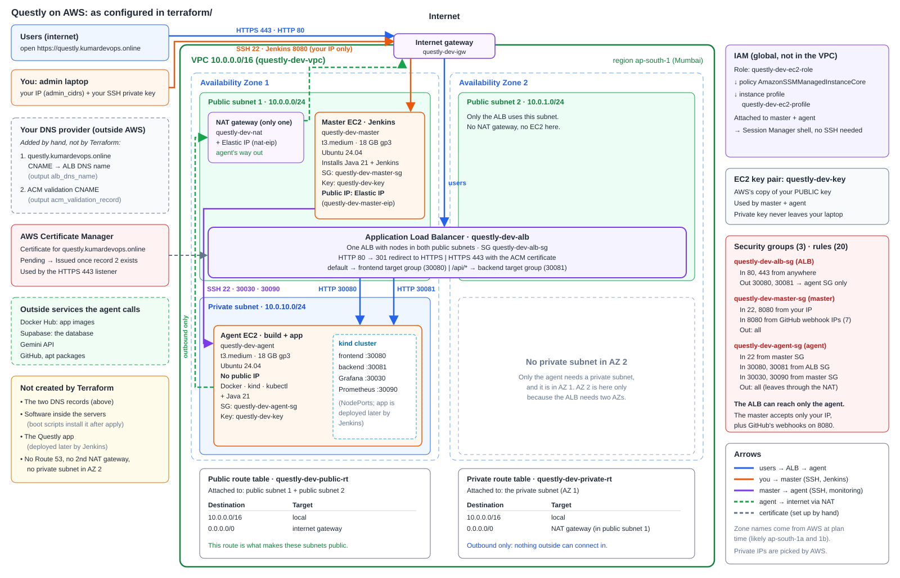

# Questly

> An AI quiz generator built as a 3-tier app, containerized with Docker,
> run on a kind Kubernetes cluster on AWS, built with Terraform, and
> deployed automatically by a Jenkins master-agent pipeline on every
> `git push`.

**Live:** <https://questly.kumardevops.online>

---

## Contents

- [What the project does](#what-the-project-does)
- [Architecture](#architecture)
- [Tech stack](#tech-stack)
- [Repository structure](#repository-structure)
- [Deploy it yourself](#deploy-it-yourself)
- [How a deployment works](#how-a-deployment-works)
- [Documentation](#documentation)

---

## What the project does

Questly generates quizzes with Google Gemini and stores users and results
in Supabase. The project's focus is the DevOps around it:

| Part | What was done |
|---|---|
| Docker | Small multi-stage images for the frontend and backend, with settings read at run time instead of build time |
| Kubernetes | A kind cluster on one EC2 server, with the app and a monitoring stack |
| Terraform | The whole AWS setup as code: VPC, subnets, NAT gateway, load balancer, HTTPS certificate, two EC2 servers |
| Jenkins | A master that receives GitHub webhooks and an agent that deploys, with email on every result |
| HTTPS | A custom domain from GoDaddy, an ACM certificate, and HTTP redirected to HTTPS |

## Architecture



```
Developer pushes to main
        │
        ▼
     GitHub ──webhook──► Jenkins master (public subnet)
                              │  SSH, inside the VPC
                              ▼
                         Jenkins agent (private subnet)
                              └── k8s/deploy.sh → kind cluster
                                                   ├── frontend :30080
                                                   └── backend  :30081
                                                          ▲
Users ──► https://questly.kumardevops.online              │
              │ (GoDaddy CNAME)                            │
              ▼                                            │
        Application Load Balancer ─────────────────────────┘
          /       → frontend
          /api/*  → backend
```

## Tech stack

| Layer | Technology |
|---|---|
| Frontend | Next.js 16, React 19, TypeScript, Tailwind CSS |
| Backend | Node.js, Express 5, TypeScript |
| Database and auth | Supabase (Postgres) |
| AI | Google Gemini API |
| Containers | Docker, Docker Hub |
| Orchestration | kind (Kubernetes in Docker), kubectl |
| Infrastructure as code | Terraform, AWS provider 6.x, state in S3 |
| Cloud | AWS: VPC, EC2, ALB, ACM, NAT gateway, IAM, Session Manager |
| DNS | GoDaddy |
| CI/CD | Jenkins (master and agent), GitHub webhook, Gmail notifications |
| Monitoring | Prometheus, Grafana, Loki, Alloy, node-exporter |

## Repository structure

```
Questly-3-tier-app/
├── frontend/              Next.js app, Dockerfile, .env.example
├── backend/               Express API, Dockerfile, .env.example
├── database/supabase/     Supabase migrations and functions
├── k8s/                   kind config, app manifests, monitoring, deploy.sh
├── terraform/             All AWS infrastructure, server boot scripts
├── data/                  Step-by-step documentation (start here)
├── Jenkinsfile            The deployment pipeline
├── docker-compose.yml     Run the whole stack locally with Docker
└── kind-setup.sh          Install Docker, kind and kubectl on a server by hand
```

## Deploy it yourself

Follow these guides in order. Each one says what must be done before it,
and links to the next.

| Step | What you do | Guide |
|---|---|---|
| 1 | Install Terraform and the AWS CLI | [Install Terraform and AWS CLI](data/03-terraform-aws/01-install-terraform-aws-cli.md) |
| 2 | Create the certificate, run `terraform apply`, and set the DNS records at GoDaddy | [Custom domain and HTTPS](data/03-terraform-aws/05-custom-domain-and-https.md), Part 4 |
| 3 | Check both servers | [After Terraform apply](data/03-terraform-aws/04-after-terraform-apply.md) |
| 4 | Connect the Jenkins master and agent | [Jenkins 1](data/04-jenkins/01-connect-master-and-agent.md) |
| 5 | Add the credentials and email settings | [Jenkins 2](data/04-jenkins/02-credentials-and-email.md) |
| 6 | Clone the repo on the agent and create the `.env` files | [Jenkins 3](data/04-jenkins/03-agent-workspace-and-env-files.md) |
| 7 | Create the pipeline, run the first build, add the GitHub webhook | [Jenkins 4](data/04-jenkins/04-pipeline-job-and-webhook.md) |
| 8 | Test the site over HTTPS | [Custom domain and HTTPS](data/03-terraform-aws/05-custom-domain-and-https.md), sections 3.9 and 3.11 |

**What you need:** an AWS account, a domain at GoDaddy (or another DNS
provider), a Supabase project, a Gemini API key, a GitHub account and a
Gmail account.

**Cost:** the NAT gateway, the load balancer and two `t3.medium` servers
are charged by the hour. Destroy everything when you stop:
[After Terraform apply → Destroy](data/03-terraform-aws/04-after-terraform-apply.md#destroy-when-you-are-done).

## How a deployment works

1. You push to `main`. GitHub sends a webhook to Jenkins on the master.
2. Jenkins hands the build to the agent over SSH.
3. The agent checks out the code and runs `k8s/deploy.sh`.
4. `deploy.sh` creates the kind cluster if needed, turns the `.env` files
   into Kubernetes secrets, and restarts the frontend and backend with the
   latest images from Docker Hub.
5. The load balancer sends visitors to the new pods once they are healthy.
6. Jenkins emails you "Build Success" or "Build Failed".

Details: [Jenkins 4: How the complete flow works](data/04-jenkins/04-pipeline-job-and-webhook.md#how-the-complete-flow-works).

## Documentation

Everything is explained step by step in [`data/`](data/README.md):

- [Docker](data/README.md#1-docker): Dockerfiles, runtime config, image size optimization
- [Kubernetes](data/README.md#2-kubernetes): kind cluster and kubectl commands
- [Terraform / AWS](data/README.md#3-terraform--aws): infrastructure, SSH, server checks, custom domain and HTTPS
- [Jenkins CI/CD](data/README.md#4-jenkins-cicd): master-agent setup, credentials, email, `.env` files, pipeline and webhook
