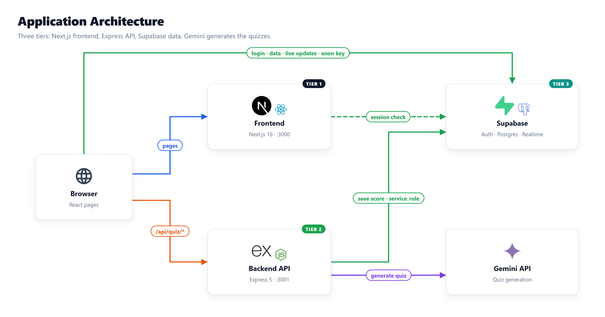
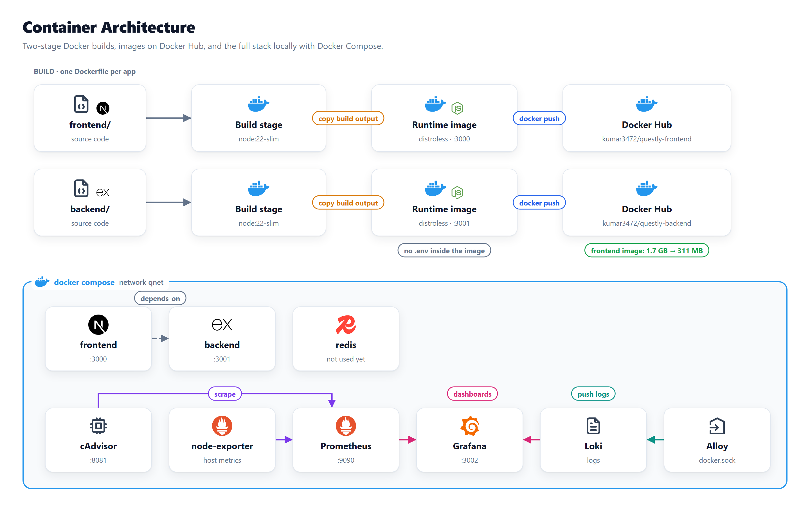
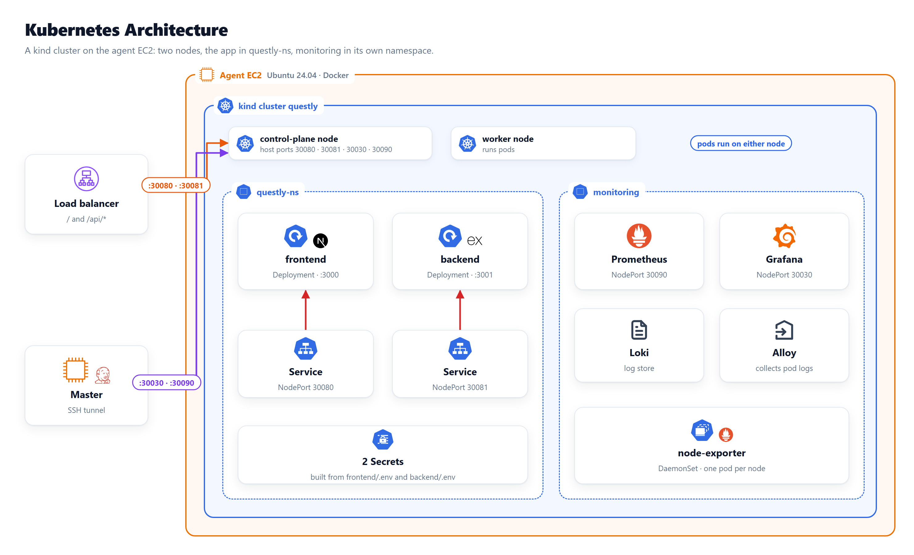
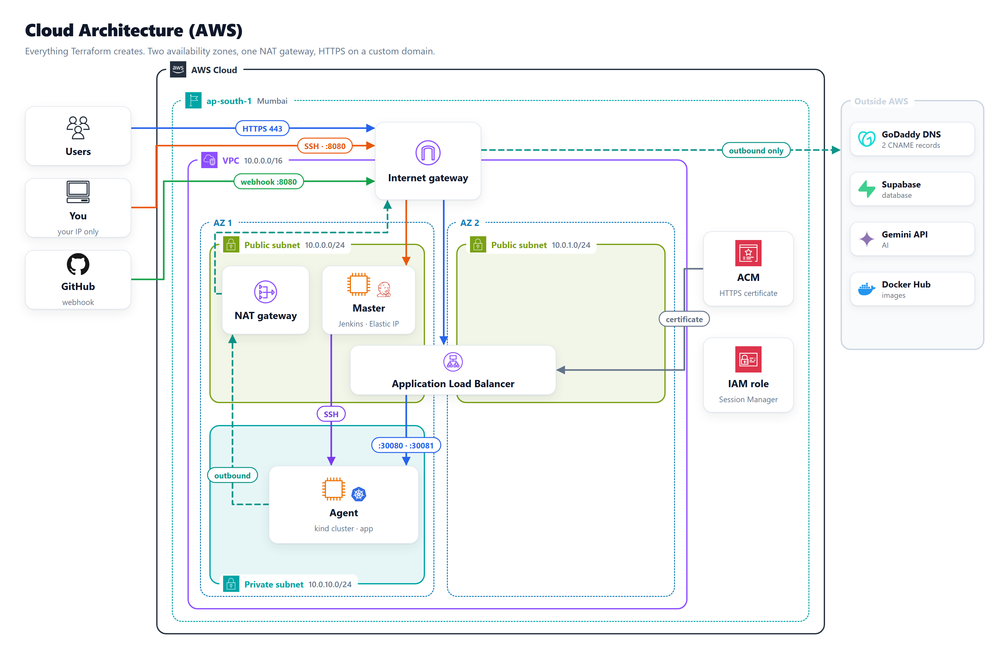
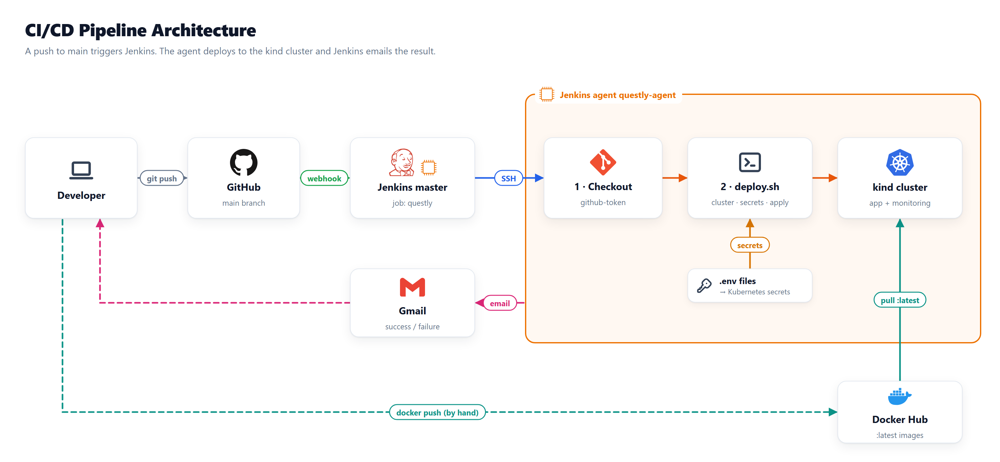
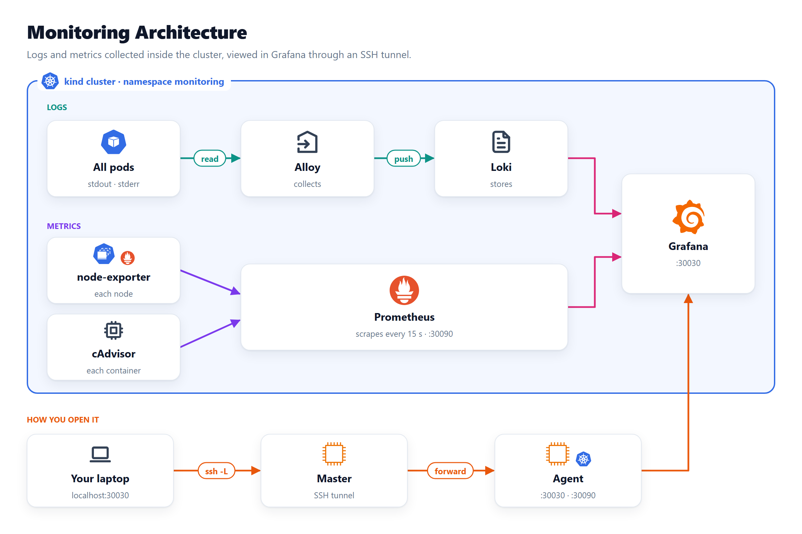

# Questly – Architecture Diagrams

Six diagrams, from the inside out: the app, its containers, the
Kubernetes cluster, the AWS infrastructure, the deployment pipeline, and
the monitoring. Each one uses the official AWS and Kubernetes icons and
the tools' own logos, with only the key words on the picture. The
explanations are below each diagram.

## Contents

1. [Application architecture](#1-application-architecture)
2. [Container architecture](#2-container-architecture)
3. [Kubernetes architecture](#3-kubernetes-architecture)
4. [Cloud architecture](#4-cloud-architecture)
5. [CI/CD pipeline architecture](#5-cicd-pipeline-architecture)
6. [Monitoring architecture](#6-monitoring-architecture)
7. [How the six fit together](#how-the-six-fit-together)
8. [Editing the diagrams](#editing-the-diagrams)

---

## 1. Application architecture



| Tier | Component | Role |
|---|---|---|
| 1 | Frontend: Next.js 16 on port 3000 | Renders the pages |
| 2 | Backend API: Express 5 on port 3001 | Generates quizzes and saves scores |
| 3 | Supabase | Login, Postgres tables, realtime updates |
| AI | Gemini API | Writes the quiz questions |

- **The browser talks to three places.**
  - **Frontend:** the pages.
  - **Backend:** `/api/quiz/*`.
  - **Supabase directly:** login, most data and live battles.
- **Two Supabase keys.**
  - **Browser:** the public **anon key**, limited by Row Level Security.
  - **Backend only:** the **service_role** key and the Gemini key.

**More:** [Supabase setup](../05-supabase/01-supabase-setup.md), [Jenkins 3: every `.env` value](../04-jenkins/03-agent-workspace-and-env-files.md)

---

## 2. Container architecture



- **Build, for each app:**
  - a **build stage** on `node:22-slim`;
  - a small **runtime image** on `distroless/nodejs22`;
  - pushed to **Docker Hub**.
- **No `.env` inside the image.** Settings are read when the container starts.
- **Run locally:** `docker compose` starts the app, Redis and the monitoring tools on one network, `qnet`.

**More:** [Docker guides](../README.md#1-docker)

---

## 3. Kubernetes architecture



- **kind runs Kubernetes inside Docker** on the agent EC2, with two nodes.
- **`questly-ns`:**
  - a Deployment and a NodePort Service each for the frontend (30080) and the backend (30081);
  - two Secrets made from the `.env` files.
- **`monitoring`:**
  - Prometheus, Grafana, Loki and Alloy;
  - node-exporter on every node.
- **How traffic gets in:**
  - **Load balancer:** sends traffic to ports 30080 and 30081.
  - **Master:** reaches 30030 and 30090 through an SSH tunnel.
  - All four ports go into the control-plane node.

**More:** [kind and kubectl commands](../02-kubernetes/01-kind-kubectl-commands.md)

---

## 4. Cloud architecture



- **One VPC** in `ap-south-1`, across two availability zones.
- **Public subnets:**
  - the **load balancer**, which spans both zones;
  - the **NAT gateway**;
  - the **master** (Jenkins).
- **Private subnet:** the **agent**, with the kind cluster and the app.
- **Traffic:**
  - **Users** reach the load balancer over HTTPS. **ACM** provides the certificate.
  - **You** reach the master over SSH and port 8080. **GitHub** reaches it for the webhook.
  - **The agent** only goes out, through the NAT gateway, to Supabase, Gemini and Docker Hub.

**More:** [Terraform resource inventory](../03-terraform-aws/02-questly-terraform-resource-inventory-and-creation-flow.md),
[Custom domain and HTTPS](../03-terraform-aws/05-custom-domain-and-https.md)

---

## 5. CI/CD pipeline architecture



1. **git push** to `main` on GitHub.
2. **Webhook:** GitHub triggers the Jenkins **master**.
3. **SSH:** the master hands the job to the agent `questly-agent`.
4. **The agent runs the pipeline:**
   - checks out the code;
   - runs `deploy.sh`, which turns the `.env` files into secrets and applies the app;
   - pulls the `:latest` images from Docker Hub into the **kind cluster**.
5. **Email:** Jenkins sends the result through **Gmail**.

Images are pushed to Docker Hub **by hand**. The pipeline deploys them; it does not build them.

**More:** [Jenkins guides](../README.md#4-jenkins-cicd)

---

## 6. Monitoring architecture



- **Logs:** every pod's output → **Alloy** → **Loki**.
- **Metrics:** **node-exporter** (each node) and **cAdvisor** (each container) → **Prometheus**, every 15 seconds.
- **Grafana** shows both.
- **Not public:** you open Grafana through an SSH tunnel: laptop → master → agent.

**More:** [After Terraform apply, section 5](../03-terraform-aws/04-after-terraform-apply.md#5-grafana-and-prometheus-optional)

---

## How the six fit together

| # | Layer | One line |
|---|---|---|
| 1 | Application | Browser, Next.js, Express, Supabase, Gemini |
| 2 | Containers | Two small Docker images on Docker Hub |
| 3 | Kubernetes | The kind cluster on the agent runs them |
| 4 | Cloud | AWS hosts the agent, the master and the load balancer |
| 5 | CI/CD | A git push makes Jenkins redeploy |
| 6 | Monitoring | Prometheus, Loki and Grafana watch it all |

---

## Editing the diagrams

The PNGs are generated from small Python scripts in [`src/`](src/):

| File | Purpose |
|---|---|
| `archlib.py` | Shared layout: cards, groups, arrows, labels |
| `d1_application.py` … `d6_monitoring.py` | One script per diagram: boxes, positions, arrows |
| `icons/` | Official AWS Architecture Icons, Kubernetes icons, Simple Icons brand logos, Tabler icons |

To change a diagram, edit its script and run it from the `src` folder:

```powershell
cd data/00-architecture/src
python d4_cloud.py
```

It writes the PNG one folder up. It needs Python with Pillow and Google
Chrome, which takes the screenshot.
