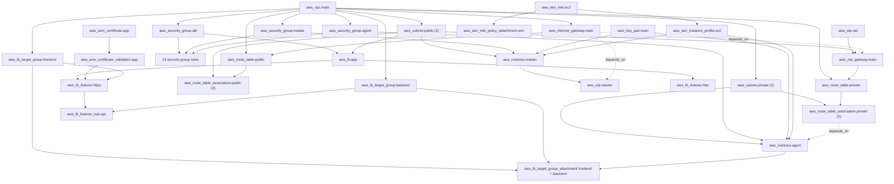

# Questly: What Happens, in Order, When You Run `terraform apply`

This guide follows one `terraform apply` in the `terraform/` folder from
the moment you press Enter until the servers finish booting. It is about
the **sequence**: what Terraform does first, what it creates next, and
why each thing has to wait for another.

## What this guide is based on

Every project fact below was read from the files in this repository.
Nothing was run against AWS to write it.

| File | Read? | What it contributes |
|---|---|---|
| `versions.tf`, `providers.tf`, `variables.tf` | Yes | Settings, provider, 45 variable declarations |
| `network.tf`, `security.tf`, `iam.tf`, `compute.tf`, `alb.tf` | Yes | 3 data sources, 43 resource blocks |
| `outputs.tf` | Yes | 3 locals, 13 outputs |
| `terraform.tfvars` | Yes | The configured values. Your admin IP is not reproduced here. |
| `terraform.tfvars.example` | Keys only | Has the same variable names as `terraform.tfvars` |
| `backend.hcl` | Yes | State key, region, encryption, lock setting. The bucket name is not reproduced here. |
| `.terraform.lock.hcl` | Yes | Provider version |
| `scripts/master-userdata.sh`, `scripts/agent-userdata.sh` | Yes | The boot scripts |
| `tfplan` | **No** | It is a binary saved plan. Its contents were not read. |
| The Terraform state (in S3) | **No** | Not accessed |
| Your AWS account, DNS, SSH key files, running servers | **No** | Not accessed |

Three labels are used where the difference matters:

- **Confirmed from repository:** read from a file listed above.
- **General Terraform behavior:** how Terraform or the AWS provider
  works, not something specific to your code.
- **Not checked:** depends on your state or your AWS account, which this
  guide did not look at.

One consequence runs through the whole guide. The values in
`terraform.tfvars` are **configured** values. They say what Terraform
will ask for. They do not prove what exists in AWS today.

---

## 1. The core distinction: loading files versus creating resources

There are two different "orders". Mixing them up is the usual source of
confusion.

| | Loading the configuration | Creating the resources |
|---|---|---|
| What it is | Terraform reading your code | Terraform asking AWS to make things |
| Where it happens | On your laptop | Requests from your laptop to AWS |
| What decides the order | Nothing. All `.tf` files are combined into one configuration. | The dependency graph: which block uses a value from which other block |
| Do file names matter? | No | No |
| Does the position of a block in a file matter? | No | No |

### Loading: one combined configuration, not nine scripts

*General Terraform behavior.* Terraform reads every `.tf` file in the
working directory and treats them as if they were one file. After that,
the file boundaries are gone. `aws_vpc.main` is just "a resource",
whichever file it was written in.

So these statements are all wrong for this project:

- "Terraform runs `variables.tf`, then `network.tf`, then `compute.tf`."
- "`network.tf` runs before `security.tf` because of its name."
- "The VPC is created first because it is near the top of its file."

If you renamed `network.tf` to `zzz.tf`, or moved the VPC block to the
bottom of it, the plan would be identical.

Each kind of block has a different job in the combined configuration:

| Kind of block | Where in this project | Its job |
|---|---|---|
| `terraform { }` | `versions.tf` | Minimum Terraform version, the AWS provider version, and that state is kept in S3 |
| `variable` | `variables.tf` (45) | Declares an input. None has a default. |
| values | `terraform.tfvars` | Supplies the value of each variable |
| `provider` | `providers.tf` | Region and three default tags |
| `locals` | `network.tf` (4), `outputs.tf` (3) | Values worked out from other values |
| `data` | `network.tf`, `compute.tf`, `iam.tf` (3) | Looks something up. Creates nothing. |
| `resource` | the five resource files (43 blocks) | Something to create and manage in AWS |
| `output` | `outputs.tf` (13) | A value printed at the end |

### `terraform init` is a separate, earlier command

*General Terraform behavior.* `terraform apply` does not run `init` for
you. `init` is what downloads the provider and connects the folder to
the state bucket. If the folder is not initialized, `apply` stops with
an error and tells you to run `init`.

*Confirmed from repository.* `versions.tf` contains an empty
`backend "s3" {}` block, and its comment says to run
`terraform init -backend-config=backend.hcl`. A `.terraform/` folder
exists with a downloaded provider and a saved backend setting, so `init`
has been run in this folder at some point.

### Creating: Terraform follows the dependency graph

*General Terraform behavior.* When one block uses a value from another
block, Terraform must create the second one first. There are two ways a
dependency is made:

**Implicit dependency.** The block refers to another block's value.
Terraform sees the reference by itself.

```hcl
# network.tf line 30
resource "aws_internet_gateway" "main" {
  vpc_id = aws_vpc.main.id      # needs the VPC's ID, so the VPC comes first
}
```

**Explicit dependency.** No value is shared, but there is a real-world
reason to wait, so the code says so with `depends_on`.

```hcl
# compute.tf line 102
# Packages are downloaded through the NAT gateway at first boot
depends_on = [aws_route_table_association.private]
```

*Confirmed from repository.* This project has exactly three
`depends_on` lines:

| Resource | Waits for | File and line |
|---|---|---|
| `aws_nat_gateway.main` | `aws_internet_gateway.main` | `network.tf` line 87 |
| `aws_eip.master` | `aws_internet_gateway.main` | `compute.tf` line 58 |
| `aws_instance.agent` | `aws_route_table_association.private` | `compute.tf` line 102 |

Every other dependency in the project is implicit.

Terraform starts a resource as soon as everything it depends on is
finished. Resources that do not depend on each other run at the same
time, up to 10 at once by default. This means **there is no single fixed
order**. Only the dependencies are guaranteed.

---

## 2. What happens after I type `terraform apply`

### Which command are you running?

*General Terraform behavior.* There are two forms, and they behave
differently:

| Command | Makes a new plan? | Asks for `yes`? |
|---|---|---|
| `terraform apply` | Yes | Yes |
| `terraform apply tfplan` | No. It applies the saved file exactly. | No. You are expected to have reviewed the file already. |

*Confirmed from repository.* A saved plan file named `tfplan` exists in
the folder. A saved plan can only be applied if the state has not
changed since it was made. If it has, Terraform rejects the file as
stale. I did not read the file, so I cannot say whether it is still
usable.

The timeline below follows plain `terraform apply`. With a saved plan,
steps 6 to 8 were already done when the plan was made, and step 9 is
skipped.

### Part A: before anything in AWS changes (steps 1 to 9)

**Step 1: Terraform starts and checks the folder is initialized**

- **What Terraform is doing:** It looks in the current folder for the
  provider and the backend setting that `init` saved earlier.
- **Code involved:** `versions.tf` (`terraform { }` block), the
  `.terraform/` folder, `.terraform.lock.hcl`.
- **Values used:** `required_version = ">= 1.6.0"`. AWS provider
  `~> 6.0`, which the lock file pins to exactly `6.68.0`. Backend type
  `s3`.
- **Why it happens now:** Terraform cannot read state or talk to AWS
  without these.
- **Result:** Terraform knows where the state lives and which provider
  program to use.
- **What waits for it:** Everything.
- **How to verify:** `terraform version` shows your Terraform and
  provider versions. *Not checked:* which Terraform version is installed
  on your laptop.

**Step 2: It loads all `.tf` files as one configuration**

- **What Terraform is doing:** Reading the nine `.tf` files and merging
  them.
- **Code involved:** `versions.tf`, `providers.tf`, `variables.tf`,
  `network.tf`, `security.tf`, `iam.tf`, `compute.tf`, `alb.tf`,
  `outputs.tf`.
- **Values used:** None yet. This is structure only: 45 variables,
  7 locals, 3 data sources, 43 resource blocks, 13 outputs.
- **Why it happens now:** Terraform needs the whole description before
  it can work out any order.
- **Result:** One configuration in memory. `scripts/` is not loaded
  here, and neither is `terraform.tfvars.example`.
- **What waits for it:** Every later step.
- **How to verify:** `terraform validate` checks that the combined
  configuration is consistent. It does not contact AWS.

**Step 3: It gives every variable a value**

- **What Terraform is doing:** Matching each `variable` block with a
  value and checking it.
- **Code involved:** `variables.tf`, `terraform.tfvars`.
- **Values used:** All 45 come from `terraform.tfvars`, which Terraform
  loads automatically because of its name. Examples:
  `project_name = "questly"`, `environment = "dev"`,
  `aws_region = "ap-south-1"`, `vpc_cidr = "10.0.0.0/16"`,
  `az_count = 2`.
- **Why it happens now:** Almost every other expression uses `var.`
  something.
- **Result:** Every `var.<name>` has a value. Three variables also have
  a `validation` block: `vpc_cidr` must be a valid range, `az_count`
  must be at least 2, and `admin_cidrs` must not be empty or contain
  `0.0.0.0/0`. A bad value stops the run here.
- **What waits for it:** The provider, the locals, and every resource.

**Step 4: It locks the state and reads it**

- **What Terraform is doing:** Putting a lock next to the state so two
  runs cannot change it at once, then downloading the state.
- **Code involved:** `backend "s3" {}` in `versions.tf`, with the
  settings from `backend.hcl` that `init` saved.
- **Values used:** `key = "questly/dev/terraform.tfstate"`,
  `region = "ap-south-1"`, `encrypt = true`, `use_lockfile = true`.
- **Why it happens now:** The state is Terraform's record of what it
  already manages. Without it, Terraform cannot tell "create" from
  "already exists".
- **Result:** Terraform knows which resources it has created before.
  *Not checked:* what your state contains right now. It may be empty,
  complete, or partial.
- **What waits for it:** The plan in step 8.

**Step 5: It configures the AWS provider**

- **What Terraform is doing:** Starting the AWS provider program and
  handing it its settings.
- **Code involved:** `provider "aws"` in `providers.tf`.
- **Values used:** `region = var.aws_region` gives `ap-south-1`. The
  three default tags are `Project = "questly"`, `Environment = "dev"`
  and `ManagedBy = "terraform"`.
- **Why it happens now:** The data sources in the next step need a
  working connection to AWS.
- **Result:** Every request goes to `ap-south-1`, and every taggable
  resource gets those three tags. `providers.tf` contains no access
  keys, so the provider looks for credentials in the standard places on
  your laptop. *Not checked:* which credentials it finds.
- **What waits for it:** Every data source and resource.
- **How to verify:** `aws sts get-caller-identity` shows which AWS
  identity your laptop is using.

**Step 6: It reads the three data sources**

- **What Terraform is doing:** Asking questions whose answers it needs
  for the plan. A data source never creates anything.
- **Code involved and values used:**

| Data source | File | Question | Answered by |
|---|---|---|---|
| `data.aws_availability_zones.available` | `network.tf` line 10 | Which zones are available in this region? | AWS |
| `data.aws_ssm_parameter.ubuntu_ami` | `compute.tf` line 2 | What image ID is stored under `var.ami_ssm_parameter`? The configured name is the Ubuntu 24.04 path published by Canonical. | AWS |
| `data.aws_iam_policy_document.ec2_assume_role` | `iam.tf` line 4 | None. It builds a JSON policy from the block. | Your laptop |

- **Why it happens now:** None of them depends on a resource, only on
  variables and the provider, so they can be read during planning.
- **Result:** A list of zone names, one image ID, and one JSON text.
  *Not checked:* the actual zone names and image ID, because they come
  from AWS at the moment you run the command.
- **What waits for it:** `local.azs` and all four subnet blocks need the
  zones. Both EC2 instances need the image ID. `aws_iam_role.ec2` needs
  the JSON.

**Step 7: It evaluates locals, expressions and files on your laptop**

- **What Terraform is doing:** Working out every value that can be
  known before AWS creates anything.
- **Code involved:** `locals` in `network.tf` lines 14 to 20, `file()`
  in `compute.tf` line 8, `templatefile()` in `compute.tf` lines 23
  and 73.
- **Values used:**

```
local.name            = "${var.project_name}-${var.environment}"  →  "questly-dev"
local.azs             = the first 2 zone names from step 6         (az_count = 2)
local.public_subnets  = { zone A = "10.0.0.0/24",  zone B = "10.0.1.0/24"  }
local.private_subnets = { zone A = "10.0.10.0/24", zone B = "10.0.11.0/24" }
```

  The subnet ranges come from
  `cidrsubnet(var.vpc_cidr, var.subnet_newbits, i + offset)` with
  `subnet_newbits = 8`, `public_subnet_offset = 0` and
  `private_subnet_offset = 10`.

  Terraform also reads the public key file named by
  `ssh_public_key_path` (configured as `~/.ssh/id_ed25519.pub`) and the
  two files in `scripts/`.
- **Why it happens now:** These need only variables, data sources and
  local files.
- **Result:** Names, subnet ranges, the key text and both boot scripts
  are ready. If the public key file is missing, the run fails here,
  before anything is sent to AWS. *Not checked:* whether that file
  exists.
- **What waits for it:** Every resource that uses `local.name`, the four
  `for_each` subnet and association blocks, `aws_key_pair.main`, and
  both instances.

Values that AWS chooses, such as `aws_vpc.main.id`, cannot be worked out
here. The plan shows them as `(known after apply)`.

**Step 8: It builds the graph and the plan**

- **What Terraform is doing:** Three things. It expands `for_each`, it
  draws the dependency graph, and it compares the code with the state
  and with AWS.
- **Code involved:** All 43 resource blocks. Eight of them use
  `for_each`.
- **Values used:** With the current `terraform.tfvars`, four blocks make
  two copies each (the public and private subnets and their route table
  associations, because `az_count = 2`). The other four make one copy
  each, because `admin_cidrs` and `app_ingress_cidrs` each hold one
  entry. That gives **47 resources from 43 blocks**.
- **Why it happens now:** Everything the plan needs is now known.
- **Result:** For each of the 47, one decision:

| Situation | Plan says |
|---|---|
| Not in the state | `+ create` |
| In the state and matches the code | nothing |
| In the state, differs, can be changed in place | `~ update in-place` |
| In the state, differs, cannot be changed in place | `-/+ replace` |
| In the state but removed from the code | `- destroy` |

  For resources already in the state, Terraform first asks AWS for their
  current settings. This is how it notices changes made by hand.

  *Not checked:* which of these your plan will show. If the state is
  empty, it is `47 to add`. If everything already exists and matches, it
  is `No changes`. Anything in between is possible.
- **What waits for it:** The approval and the whole of Part B.
- **How to verify:** `terraform plan` does steps 1 to 8 and stops. It
  changes nothing in AWS. Read the last line:
  `Plan: X to add, Y to change, Z to destroy.`

**Step 9: It shows the plan and waits for you**

- **What Terraform is doing:** Printing the plan and asking
  `Enter a value:`.
- **Why it happens now:** This is the last moment before AWS changes.
- **Result:** Only the exact word `yes` continues. Anything else
  cancels, and nothing was changed.
- **What waits for it:** Part B.

### Part B: Terraform changes AWS (steps 10 to 21)

Read this part with three things in mind:

1. Each step happens **only for resources your plan marked to create**.
   If a resource already exists and matches, its step is skipped.
2. The step numbers are an **illustrative** order that respects the
   dependencies. Steps on different branches overlap in time. Your
   terminal will print them in a different order.
3. After each resource finishes, Terraform writes it to the state
   straight away. If a later resource fails, the finished ones stay
   created and recorded.

**Step 10: The resources that depend on nothing**

- **What Terraform is doing:** Starting five resources at once.
- **Code involved and values used:**

| Resource | File | Key values | Why it is needed |
|---|---|---|---|
| `aws_vpc.main` | `network.tf` line 22 | `cidr_block = var.vpc_cidr` gives `10.0.0.0/16` | The private network that holds everything |
| `aws_eip.nat` | `network.tf` line 75 | `domain = "vpc"` | A fixed public IP for the NAT gateway |
| `aws_key_pair.main` | `compute.tf` line 6 | Name `questly-dev-key`, public key text from step 7 | Lets you log in to both servers over SSH |
| `aws_iam_role.ec2` | `iam.tf` line 15 | Name `questly-dev-ec2-role`, policy JSON from step 6 | The identity the servers use for Session Manager |
| `aws_acm_certificate.app` | `alb.tf` line 74 | `domain_name = var.app_domain_name`, `validation_method = "DNS"` | The HTTPS certificate for the app's domain |

- **Why it happens now:** None of them refers to another resource. They
  use only variables, locals, data sources and local files.
- **Result:** AWS returns an ID for each. The certificate exists but is
  not issued yet. AWS also returns the DNS record it wants as proof that
  you own the domain.
- **What waits for it:** Nearly everything waits for the VPC. The NAT
  gateway waits for `aws_eip.nat`. Both instances wait for the key pair.
  The policy attachment and the instance profile wait for the role. The
  certificate validation waits for the certificate.

**Step 11: The resources that need only the VPC, the role or the certificate**

- **What Terraform is doing:** Starting everything that step 10
  unlocked.
- **Code involved and values used:**

| Resource | File | Waits for | Why it is needed |
|---|---|---|---|
| `aws_internet_gateway.main` | `network.tf` line 30 | VPC | Connects the VPC to the internet |
| `aws_subnet.public` (2) | `network.tf` line 40 | VPC | `10.0.0.0/24` and `10.0.1.0/24`: load balancer, NAT gateway, master |
| `aws_subnet.private` (2) | `network.tf` line 56 | VPC | `10.0.10.0/24` and `10.0.11.0/24`: the agent |
| `aws_security_group.alb`, `.master`, `.agent` | `security.tf` lines 13, 21, 29 | VPC | Three firewalls. They contain no rules yet. |
| `aws_lb_target_group.frontend`, `.backend` | `alb.tf` lines 26, 41 | VPC | Where the load balancer forwards to: ports `30080` and `30081` |
| `aws_iam_role_policy_attachment.ssm` | `iam.tf` line 20 | IAM role | Gives the role the Session Manager policy |
| `aws_iam_instance_profile.ec2` | `iam.tf` line 25 | IAM role | The wrapper that lets an EC2 instance use the role |
| `aws_acm_certificate_validation.app` | `alb.tf` line 86 | certificate | See step 19 |

- **Why it happens now:** Each one has `vpc_id = aws_vpc.main.id`,
  `role = aws_iam_role.ec2.name` or
  `certificate_arn = aws_acm_certificate.app.arn`. Those values exist
  only after step 10.
- **Result:** The network's parts exist but are not connected by routes
  yet. The security groups are empty.
- **What waits for it:** Steps 12 to 20.

**Step 12: The 13 security group rules**

- **What Terraform is doing:** Adding rules to the three empty groups.
  Each rule is its own resource.
- **Code involved:** `security.tf` lines 41 to 168.
- **Values used:** Ports from `terraform.tfvars`: `ssh_port = 22`,
  `jenkins_port = 8080`, `alb_listener_port = 80`,
  `alb_https_port = 443`, the two app ports and the two monitoring
  ports. SSH and Jenkins on the master are opened only to the addresses
  in `admin_cidrs`.
- **Why it happens now:** Every rule has a `security_group_id`, so it
  waits for its own group. Seven rules also name a second group in
  `referenced_security_group_id`, so they wait for two groups. For
  example `alb_to_frontend` (line 63) belongs to the ALB group and
  points at the agent group.
- **Result:** The load balancer may reach the agent's app ports, the
  master may reach the agent over SSH, and both servers may send traffic
  out (`master_all`, `agent_all`).
- **What waits for it:** **Nothing.** No resource refers to a rule. This
  matters for steps 16 and 20: Terraform does not make the instances
  wait for their rules. In practice the rules take seconds and a server
  takes much longer to boot.

**Step 13: The public route table and its associations**

- **What Terraform is doing:** Creating the route "all internet traffic
  goes to the internet gateway", then attaching both public subnets to
  it.
- **Code involved:** `aws_route_table.public` (`network.tf` line 94),
  then `aws_route_table_association.public` (line 105, 2 copies).
- **Why it happens now:** The route table uses `aws_vpc.main.id` and
  `aws_internet_gateway.main.id`. The associations use the subnets' IDs
  and the route table's ID, so they come after it.
- **Result:** The two public subnets can actually reach the internet.
- **What waits for it:** Nothing refers to these associations.

**Step 14: The NAT gateway**

- **What Terraform is doing:** Creating the gateway that gives the
  private subnets outbound internet access.
- **Code involved:** `aws_nat_gateway.main` (`network.tf` line 81).
- **Values used:** `allocation_id = aws_eip.nat.id` and
  `subnet_id = aws_subnet.public[local.azs[0]].id`, which is the public
  subnet in the first zone.
- **Why it happens now:** It needs the IP from step 10 and a public
  subnet from step 11. `depends_on` on line 87 also makes it wait for
  the internet gateway.
- **Result:** A working NAT gateway. *General Terraform behavior:* the
  provider waits until AWS reports it as available, which typically
  takes a minute or more. You see `Still creating...` lines.
- **What waits for it:** The private route table (step 18), and through
  it the agent.

**Step 15: The load balancer**

- **What Terraform is doing:** Creating the public Application Load
  Balancer.
- **Code involved:** `aws_lb.app` (`alb.tf` line 14).
- **Values used:** Name `questly-dev-alb`,
  `security_groups = [aws_security_group.alb.id]`,
  `subnets = [for s in aws_subnet.public : s.id]`, which is both public
  subnets.
- **Why it happens now:** It needs the ALB security group and both
  public subnets from step 11.
- **Result:** A load balancer with a DNS name, but no listeners yet, so
  it answers nothing. This is usually one of the slower resources.
- **What waits for it:** Both listeners (step 19) and the `alb_dns_name`
  output.

**Step 16: The master server is launched, and its boot script is handed over**

- **What Terraform is doing:** Asking AWS to start the Jenkins server.
- **Code involved:** `aws_instance.master` (`compute.tf` line 15).
- **Values used:**

| Argument | Comes from | Value |
|---|---|---|
| `ami` | `data.aws_ssm_parameter.ubuntu_ami.value` | The image ID from step 6 |
| `instance_type` | `var.master_instance_type` | `t3.medium` |
| `subnet_id` | `aws_subnet.public[local.azs[0]].id` | The public subnet in the first zone |
| `vpc_security_group_ids` | `aws_security_group.master.id` | The master's group |
| `key_name` | `aws_key_pair.main.key_name` | `questly-dev-key` |
| `iam_instance_profile` | `aws_iam_instance_profile.ec2.name` | `questly-dev-ec2-profile` |
| `user_data` | `templatefile(".../scripts/master-userdata.sh", {...})` | The script text from step 7 |

- **Why it happens now:** It needs the subnet, security group, key pair
  and instance profile. All were created in steps 10 and 11.
- **Result:** AWS reports the instance as running, and Terraform records
  it. The script travels inside the launch request. **Terraform does not
  run it** and never connects to the server.
- **What waits for it:** `aws_eip.master` (step 17).

Two details that are confirmed from the repository:

- `templatefile()` is given five values, but the script contains no
  `${...}` placeholders. So the script is sent exactly as written, and
  those five values have no effect on it.
- `lifecycle { ignore_changes = [ami, user_data] }` (lines 47 to 49)
  means that once the master exists, a newer Ubuntu image or an edited
  script does not cause Terraform to replace it.

**Step 17: The master's public IP**

- **What Terraform is doing:** Reserving a fixed public IP and attaching
  it to the master.
- **Code involved:** `aws_eip.master` (`compute.tf` line 52).
- **Why it happens now:** `instance = aws_instance.master.id` needs the
  instance. `depends_on` on line 58 also names the internet gateway.
- **Result:** The master is reachable from the addresses in
  `admin_cidrs`. Before this step it has no public IP, because the
  public subnets set `map_public_ip_on_launch = false`.
- **What waits for it:** The outputs `master_public_ip`, `jenkins_url`,
  `ssh_master`, `ssh_agent` and `monitoring_tunnel`.

The master's boot script needs the internet, which needs this IP and the
routes from step 13. The master does not depend on either of them, so
Terraform does not guarantee they exist before the server boots. They
are quick to create, but it is timing, not a dependency.

**Step 18: The private route table and its associations**

- **What Terraform is doing:** Creating the route "all internet traffic
  goes to the NAT gateway", then attaching both private subnets to it.
- **Code involved:** `aws_route_table.private` (`network.tf` line 112),
  then `aws_route_table_association.private` (line 123, 2 copies).
- **Why it happens now:** The route uses `aws_nat_gateway.main.id`, so
  it must wait for the slow step 14.
- **Result:** Anything in a private subnet can now reach the internet,
  outbound only.
- **What waits for it:** The agent (step 20), through `depends_on`.

**Step 19: The certificate is confirmed, then the listeners and the API rule**

- **What Terraform is doing:** Waiting for the certificate, then telling
  the load balancer what to do with requests.
- **Code involved and values used:**

| Resource | File | Waits for | What it does |
|---|---|---|---|
| `aws_acm_certificate_validation.app` | `alb.tf` line 86 | certificate | Creates nothing. It waits until AWS marks the certificate as issued. |
| `aws_lb_listener.http` | `alb.tf` line 94 | load balancer | Port `80`: redirects every request to HTTPS |
| `aws_lb_listener.https` | `alb.tf` line 110 | load balancer, **validation**, frontend target group | Port `443`: sends requests to the frontend |
| `aws_lb_listener_rule.api` | `alb.tf` line 123 | HTTPS listener, backend target group | Sends `/api/*` to the backend |

- **Why it happens now:** The HTTPS listener takes its certificate from
  `aws_acm_certificate_validation.app.certificate_arn`, not from the
  certificate directly. That one reference is what forces "issued"
  before "listener".
- **Result:** The load balancer accepts HTTPS for the configured domain.
- **What waits for it:** Nothing else.

AWS issues the certificate only after it finds a specific DNS record for
your domain. *Confirmed from repository:* no resource in this project
creates that record. The `acm_validation_record` output prints it so it
can be added at the DNS provider by hand. *General Terraform behavior:*
if the record is not there, the validation resource keeps waiting and
eventually fails. The HTTPS listener and the API rule wait behind it.
Resources on other branches are not blocked. *Not checked:* whether the
record exists in your DNS.

**Step 20: The agent server is launched**

- **What Terraform is doing:** Asking AWS to start the server that will
  run the kind cluster.
- **Code involved:** `aws_instance.agent` (`compute.tf` line 65).
- **Values used:** The same image, key pair and instance profile as the
  master. `instance_type = var.agent_instance_type` gives `t3.medium`.
  `subnet_id = aws_subnet.private[local.azs[0]].id` puts it in the
  private subnet of the first zone. `user_data` is
  `scripts/agent-userdata.sh`.
- **Why it happens now:** Its arguments need only things from steps 10
  and 11. What holds it back is line 102:
  `depends_on = [aws_route_table_association.private]`. The boot script
  downloads Docker, kind and kubectl. A server in a private subnet can
  do that only when the route through the NAT gateway exists.
- **Result:** The instance is running. Its boot script was handed over
  the same way as the master's.
- **What waits for it:** The two target group attachments (step 21) and
  the outputs `agent_private_ip`, `ssh_agent` and `monitoring_tunnel`.

Confirmed from the repository, as for the master: the agent script has
no `${...}` placeholders, so the six values passed to `templatefile()`
do not change it. For example, it downloads the latest kind and the
latest stable kubectl whatever `kind_version` and `kubectl_version` say.
The agent also has `ignore_changes = [ami, user_data]`.

**Step 21: The agent is registered with the load balancer**

- **What Terraform is doing:** Adding the agent to both target groups.
- **Code involved:** `aws_lb_target_group_attachment.frontend` and
  `.backend` (`alb.tf` lines 56 and 62).
- **Values used:** `target_id = aws_instance.agent.id`, with ports
  `30080` and `30081`.
- **Why it happens now:** It needs the agent's ID. That makes these two
  the end of the longest chain.
- **Result:** The load balancer knows where to send traffic.
- **What waits for it:** Nothing.

### Part C: finishing (steps 22 to 24)

**Step 22: The outputs are worked out**

- **What Terraform is doing:** Evaluating the 13 `output` blocks and the
  3 locals in `outputs.tf`.
- **Why it happens now:** Outputs use values from finished resources,
  for example `aws_eip.master.public_ip` and
  `aws_instance.agent.private_ip`.
- **Result:** The values are saved in the state.

**Step 23: The state is saved and unlocked**

- **What Terraform is doing:** Writing the final state, removing the
  lock, and printing the summary line and the outputs.
- **Result:** `Apply complete! Resources: X added, Y changed, Z
  destroyed.` The numbers match the plan you approved.

**Step 24: The boot scripts run inside the servers. This is not Terraform.**

- **What is happening:** Terraform has already exited. Inside each new
  server, a program called cloud-init, which is part of the Ubuntu
  image, runs the script it was given at launch. It runs once, on the
  first boot.
- **Code involved:** `scripts/master-userdata.sh` installs Java and
  Jenkins and starts Jenkins. `scripts/agent-userdata.sh` installs Java,
  Docker, Docker Compose, kind and kubectl.
- **Result:** Some minutes after `Apply complete!`, the software is
  installed, if the script succeeded. Terraform does not know whether it
  did. Section 6 shows how to check.

---

## 3. Dependency stages

The stages below group the 47 resources by how many dependency steps
they are from the start. They are **illustrative**. A resource in
stage 3 does not wait for all of stage 2. It waits only for the specific
resources named in its "Waits for" column. Resources in the same stage
never depend on each other, which is why they can run in parallel.

| Stage | Resources | Count | Waits for (the reference that creates the dependency) |
|---|---|---|---|
| 1 | `aws_vpc.main`, `aws_eip.nat`, `aws_key_pair.main`, `aws_iam_role.ec2`, `aws_acm_certificate.app` | 5 | No resource |
| 2 | `aws_internet_gateway.main`, `aws_subnet.public` (2), `aws_subnet.private` (2), `aws_security_group.alb`/`.master`/`.agent`, `aws_lb_target_group.frontend`/`.backend` | 10 | `vpc_id = aws_vpc.main.id` |
| 2 | `aws_iam_role_policy_attachment.ssm`, `aws_iam_instance_profile.ec2` | 2 | `role = aws_iam_role.ec2.name` |
| 2 | `aws_acm_certificate_validation.app` | 1 | `certificate_arn = aws_acm_certificate.app.arn` |
| 3 | 13 security group rules | 13 | `security_group_id` and, for 7 of them, `referenced_security_group_id` |
| 3 | `aws_route_table.public` | 1 | `aws_vpc.main.id`, `aws_internet_gateway.main.id` |
| 3 | `aws_nat_gateway.main` | 1 | `aws_eip.nat.id`, `aws_subnet.public[...].id`, `depends_on` internet gateway |
| 3 | `aws_lb.app` | 1 | `aws_security_group.alb.id`, both `aws_subnet.public` IDs |
| 3 | `aws_instance.master` | 1 | public subnet, `aws_security_group.master.id`, `aws_key_pair.main.key_name`, `aws_iam_instance_profile.ec2.name` |
| 4 | `aws_route_table_association.public` (2) | 2 | `aws_subnet.public`, `aws_route_table.public.id` |
| 4 | `aws_route_table.private` | 1 | `aws_vpc.main.id`, `aws_nat_gateway.main.id` |
| 4 | `aws_eip.master` | 1 | `aws_instance.master.id`, `depends_on` internet gateway |
| 4 | `aws_lb_listener.http` | 1 | `aws_lb.app.arn` |
| 4 | `aws_lb_listener.https` | 1 | `aws_lb.app.arn`, `aws_acm_certificate_validation.app.certificate_arn`, `aws_lb_target_group.frontend.arn` |
| 5 | `aws_route_table_association.private` (2) | 2 | `aws_subnet.private`, `aws_route_table.private.id` |
| 5 | `aws_lb_listener_rule.api` | 1 | `aws_lb_listener.https.arn`, `aws_lb_target_group.backend.arn` |
| 6 | `aws_instance.agent` | 1 | private subnet, `aws_security_group.agent.id`, key pair, instance profile, `depends_on` private associations |
| 7 | `aws_lb_target_group_attachment.frontend`, `.backend` | 2 | target group ARN, `aws_instance.agent.id` |

5 + 13 + 17 + 6 + 3 + 1 + 2 = 47.

The same graph as a picture. An arrow means "must exist first".



Three things the graph shows:

- **Four independent branches start at once:** the network (from the
  VPC), the SSH key, the IAM role, and the certificate.
- **The certificate branch joins late.** It touches nothing else until
  the HTTPS listener.
- **Nothing depends on the security group rules, the public route table
  associations or the policy attachment.** Terraform finishes them
  before it reports success, but no other resource waits for them.

---

## 4. One end-to-end dependency chain

The longest chain in the graph has seven links. It explains why the
agent and its load balancer registration finish last.

```
aws_vpc.main
   │  network.tf line 43:   vpc_id = aws_vpc.main.id
   ▼
aws_subnet.public[<first zone>]
   │  network.tf line 83:   subnet_id = aws_subnet.public[local.azs[0]].id
   ▼
aws_nat_gateway.main           (also needs aws_eip.nat, line 82,
   │                            and the internet gateway, line 87)
   │  network.tf line 117:  nat_gateway_id = aws_nat_gateway.main.id
   ▼
aws_route_table.private
   │  network.tf line 127:  route_table_id = aws_route_table.private.id
   ▼
aws_route_table_association.private   (2 copies)
   │  compute.tf line 102:  depends_on = [aws_route_table_association.private]
   ▼
aws_instance.agent
   │  alb.tf lines 58, 64:  target_id = aws_instance.agent.id
   ▼
aws_lb_target_group_attachment.frontend and .backend
```

Read it as cause and effect:

1. The NAT gateway must sit in a public subnet. Therefore it waits for
   the subnet, which waits for the VPC.
2. The private route points at the NAT gateway. Therefore it waits for
   the NAT gateway, which is slow.
3. The private subnets must be attached to that route before anything in
   them can reach the internet.
4. The agent's boot script downloads software. The agent's own arguments
   do not mention the route, so Terraform would not see this need. The
   `depends_on` line states it by hand.
5. The load balancer can only register a server that exists. Therefore
   the attachments wait for the agent.

Every link except the fourth is an implicit dependency.

---

## 5. Where key values come from

Only the values that shape the sequence are traced here.

**The name prefix.** It needs no resource, so it is known in step 7.

```
terraform.tfvars   project_name = "questly", environment = "dev"
      → variables.tf   variable "project_name", variable "environment"
      → network.tf line 15   local.name = "${var.project_name}-${var.environment}"
      → "questly-dev"
      → names such as questly-dev-vpc, questly-dev-key, questly-dev-alb
```

**The subnet ranges.** Known in step 7, which is why the subnets can
start as soon as the VPC exists.

```
terraform.tfvars   vpc_cidr = "10.0.0.0/16", subnet_newbits = 8, offsets 0 and 10
      + data.aws_availability_zones.available (asked from AWS) and az_count = 2
      → network.tf lines 16 to 19   local.azs, local.public_subnets, local.private_subnets
      → for_each on aws_subnet.public and aws_subnet.private
      → 4 subnets: 10.0.0.0/24, 10.0.1.0/24, 10.0.10.0/24, 10.0.11.0/24
```

**The VPC ID.** This is the value that orders most of the graph. AWS
chooses it, so it is unknown until step 10.

```
AWS creates the VPC and returns its ID
      → saved in the state as aws_vpc.main.id
      → vpc_id on the gateway, 4 subnets, 2 route tables, 3 security groups, 2 target groups
```

**The server image.** Looked up in step 6, so it never delays the
instances.

```
terraform.tfvars   ami_ssm_parameter = "/aws/service/canonical/ubuntu/server/24.04/..."
      → compute.tf line 2   data.aws_ssm_parameter.ubuntu_ami
      → compute.tf lines 16 and 66   ami = data.aws_ssm_parameter.ubuntu_ami.value
```

**The SSH key.** Four different things are involved:

| Thing | Where it is | What Terraform does with it |
|---|---|---|
| Public key file | Your laptop, at the path in `ssh_public_key_path` | Reads its text in step 7 |
| `aws_key_pair.main` | AWS | Stores that text under the name `questly-dev-key` (step 10) |
| `key_name` on both instances | AWS | Tells AWS to install that public key for the login user at first boot (steps 16 and 20) |
| Private key file | Your laptop | **Never read by Terraform.** Your SSH client uses it when you connect. |

```
terraform.tfvars   ssh_public_key_path = "~/.ssh/id_ed25519.pub"
      → compute.tf line 8   public_key = file(pathexpand(var.ssh_public_key_path))
      → aws_key_pair.main.key_name
      → compute.tf lines 20 and 70   key_name on aws_instance.master and aws_instance.agent
```

`outputs.tf` line 3 builds `local.ssh_private_key_path` by removing
`.pub` from the same path. That is only text for the printed `ssh`
commands. Terraform does not open that file. *Not checked:* whether
either key file exists on your laptop.

**The instance profile.** A two-link chain that both instances wait for.

```
iam.tf line 15   aws_iam_role.ec2
      → iam.tf line 27   aws_iam_instance_profile.ec2 (role = aws_iam_role.ec2.name)
      → compute.tf lines 21 and 71   iam_instance_profile = aws_iam_instance_profile.ec2.name
```

**The domain and the certificate.** This is what gates HTTPS.

```
terraform.tfvars   app_domain_name = "questly.kumardevops.online"
      → alb.tf line 75    aws_acm_certificate.app (domain_name)
      → alb.tf line 87    aws_acm_certificate_validation.app (waits until issued)
      → alb.tf line 115   aws_lb_listener.https (certificate_arn)
      → alb.tf line 124   aws_lb_listener_rule.api (listener_arn)
```

**The app ports.** One value is used in three places, which keeps the
firewall, the load balancer and the registration in agreement.

```
terraform.tfvars   frontend_node_port = 30080
      → security.tf   the ALB egress rule and the agent ingress rule
      → alb.tf line 28   aws_lb_target_group.frontend (port)
      → alb.tf line 59   aws_lb_target_group_attachment.frontend (port)
```

**The boot scripts.**

```
scripts/master-userdata.sh, scripts/agent-userdata.sh   (files on your laptop)
      → compute.tf lines 23 and 73   user_data = templatefile(...)
      → sent to AWS inside the request that launches the instance
      → run by cloud-init inside the instance on first boot
```

---

## 6. What happens after apply

### What `Apply complete!` means

| It means | It does not mean |
|---|---|
| AWS accepted every request in the plan | Jenkins is installed and running |
| Each resource reached the state the provider waits for, for example an instance is "running" | Docker, kind and kubectl are installed on the agent |
| The state now records each resource and its real ID | The Questly app is deployed |
| The outputs are available | The load balancer's health checks pass |

*Confirmed from repository.* Terraform only creates the infrastructure.
Nothing in `terraform/` deploys the app. Until something listens on
ports `30080` and `30081` on the agent, the target groups will report it
as unhealthy. Deployment is covered in
[04-after-terraform-apply.md](04-after-terraform-apply.md).

### The state

*Confirmed from repository.* The state is stored in an S3 bucket under
the key `questly/dev/terraform.tfstate`, in `ap-south-1`, encrypted,
with a lock file used during runs.

The state is Terraform's record of which real AWS object belongs to
which block in your code. It is what lets the next `terraform apply`
change only the difference instead of creating everything again. It is
not a copy of your `.tf` files.

### The outputs

Outputs are worked out at the end of the apply and saved in the state.
You can print them again at any time:

```powershell
terraform output
```

*Confirmed from repository.* There are 13: `app_url`,
`next_public_api_base_url`, `alb_dns_name`, `acm_validation_record`,
`jenkins_url`, `master_public_ip`, `agent_private_ip`, `ssh_master`,
`ssh_agent`, `monitoring_tunnel`, `vpc_id`, `public_subnet_ids` and
`private_subnet_ids`.

### How to check, without changing anything

Run these from the `terraform` folder.

| Command | What it proves |
|---|---|
| `terraform plan` | Whether the code, the state and AWS agree. `No changes` means they do. It briefly locks the state but changes nothing in AWS. |
| `terraform state list` | Which resources Terraform currently manages. After a complete apply with the current values there are 47, plus the 3 data sources. |
| `terraform state show aws_instance.master` | The real ID and settings Terraform recorded for one resource. |
| `terraform output` | The URLs, IPs and ready-made SSH commands. |
| `terraform graph` | The dependency graph Terraform built, as text. It is the source of truth for sections 3 and 4. |

To check that a boot script finished, log in with the command from the
`ssh_master` or `ssh_agent` output, then run:

```bash
cloud-init status --wait
sudo tail -n 50 /var/log/cloud-init-output.log
```

| Result | Meaning |
|---|---|
| `status: done` | The script finished |
| `status: running` | It is still installing. Wait. |
| `status: error` | It failed. The end of the log shows where. |

*Confirmed from repository.* Both scripts begin with `set -e`, so a
script stops at its first failing command. The error is therefore near
the end of the log.

---

## 7. Short recap

1. `terraform init` was run earlier. `apply` does not repeat it.
2. Terraform loads all nine `.tf` files as **one** configuration. File
   names and block positions decide nothing.
3. Variables get their values from `terraform.tfvars`.
4. Terraform locks and reads the state in S3, then starts the AWS
   provider for `ap-south-1`.
5. It reads three data sources: the zones, the Ubuntu image ID, and a
   locally built IAM policy.
6. It works out locals, reads the public key file and both boot scripts,
   and builds the dependency graph.
7. It compares code, state and AWS, shows the plan, and waits for `yes`.
   What the plan contains depends on your current state.
8. It creates whatever the plan lists, starting with resources that need
   nothing: the VPC, the NAT IP, the key pair, the IAM role and the
   certificate.
9. Each finished resource unlocks the ones that refer to it. Independent
   resources run in parallel, so the exact order varies between runs.
10. The longest chain is VPC → public subnet → NAT gateway → private
    route table → its associations → agent → load balancer registration.
11. The HTTPS listener waits for the certificate to be issued, which
    needs a DNS record that Terraform does not create.
12. Terraform works out the outputs, saves and unlocks the state, and
    prints `Apply complete!`.
13. After Terraform has exited, cloud-init runs the boot script inside
    each new server. Terraform does not wait for it or check it.
