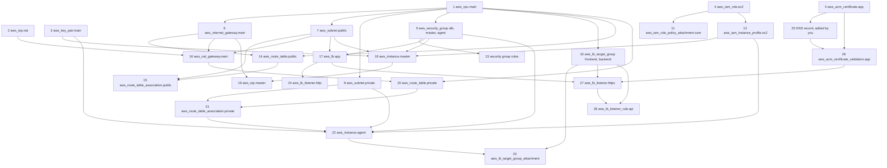

# Questly Terraform: What Gets Created, in What Order, and How

This guide has three parts:

1. **The list:** everything the Terraform code will create.
2. **The order:** the same things, arranged in the order Terraform
   creates them.
3. **One by one:** each item from the order, with the exact steps
   Terraform takes to create it.

Everything here was read from the files in `terraform/`. The values are
what the code is set to ask for. Nothing was checked in your AWS
account, so this describes what Terraform **will do**, not what exists
right now.

---

# PART 1: The list of what will be created

All names start with `questly-dev`. The region is `ap-south-1` (Mumbai).
In total: **47 AWS resources**.

## Servers: 2 EC2 instances

**Master EC2 (Jenkins server)**

- Instance type: `t3.medium` (not `t2.medium`)
- Storage: 18 GB, type `gp3`, encrypted
- Operating system: Ubuntu 24.04
- SSH key: `questly-dev-key`
- Network: inside the project's own VPC, in a **public subnet**
- Security group: its own, `questly-dev-master-sg`
- Public IP: yes, a fixed one (1 Elastic IP for the master)
- Boot script: installs Java 21 and Jenkins

**Agent EC2 (build server, runs the kind cluster)**

- Instance type: `t3.medium`
- Storage: 18 GB, type `gp3`, encrypted
- Operating system: Ubuntu 24.04
- SSH key: the same `questly-dev-key`
- Network: inside the same VPC, in a **private subnet**
- Security group: its own, `questly-dev-agent-sg`
- Public IP: none
- Boot script: installs Java 21, Docker, Docker Compose, kind and
  kubectl

## SSH key: 1 key pair

- `questly-dev-key`: a copy of your public key, stored in AWS and used
  by both servers

## Network: 1 separate VPC and everything inside it

- 1 VPC, `10.0.0.0/16` (the project's own, not the AWS default VPC)
- 1 internet gateway
- 2 public subnets: `10.0.0.0/24` and `10.0.1.0/24`
- 2 private subnets: `10.0.10.0/24` and `10.0.11.0/24`
- 1 Elastic IP for the NAT gateway
- 1 NAT gateway (in the first public subnet)
- 1 public route table (internet traffic → internet gateway)
- 2 public route table associations (one per public subnet)
- 1 private route table (internet traffic → NAT gateway)
- 2 private route table associations (one per private subnet)

## Security: 3 security groups and 13 rules

- 1 security group for the master, with 3 rules:
  - SSH (port 22) in, only from your IP
  - Jenkins (port 8080) in, only from your IP
  - everything out
- 1 security group for the agent, with 6 rules:
  - SSH (port 22) in, only from the master
  - frontend (port 30080) in, only from the load balancer
  - backend (port 30081) in, only from the load balancer
  - Grafana (port 30030) in, only from the master
  - Prometheus (port 30090) in, only from the master
  - everything out
- 1 security group for the load balancer, with 4 rules:
  - HTTP (port 80) in, from anywhere
  - HTTPS (port 443) in, from anywhere
  - out to the agent on port 30080
  - out to the agent on port 30081

## Permissions: 3 IAM resources

- 1 IAM role, `questly-dev-ec2-role`
- 1 policy attachment (gives the role AWS Session Manager access)
- 1 instance profile, `questly-dev-ec2-profile` (hands the role to both
  servers)

## Load balancer: 1 ALB and its parts

- 1 Application Load Balancer, `questly-dev-alb`, public, in both public
  subnets
- 2 target groups:
  - frontend → agent port 30080
  - backend → agent port 30081
- 2 target group attachments (they put the agent into each target group)
- 1 HTTP listener on port 80 (redirects to HTTPS)
- 1 HTTPS listener on port 443 (sends to the frontend)
- 1 listener rule: `/api/*` goes to the backend

## HTTPS: ACM certificate

- 1 certificate **request** for `questly.kumardevops.online`
- 1 certificate validation (Terraform waits here until AWS approves the
  certificate)
- **Manual, not Terraform:** one DNS record that you must add at your
  domain provider, so AWS can approve the certificate

## Count

| Group | Resources |
|---|---|
| Network | 14 |
| Security groups and rules | 16 |
| IAM | 3 |
| Key pair, 2 servers, master's Elastic IP | 4 |
| Load balancer, target groups, attachments, listeners, rule | 8 |
| Certificate and validation | 2 |
| **Total** | **47** |

## Not created by Terraform

- The DNS record for certificate approval (you add it)
- The DNS record that points your domain at the load balancer (you add
  it)
- The software inside the servers (the boot scripts install it after
  Terraform is done)
- The Questly app itself (deployed later)

---

# PART 2: The order of creation

## How Terraform decides the order

Terraform does **not** go file by file. It reads all the `.tf` files
together, then looks at which resource needs a value from which other
resource. A resource is created as soon as everything it needs exists.

Example: a subnet needs the VPC's ID, so the VPC comes first. The key
pair needs nothing, so it can start right away.

Resources that do not need each other are created **at the same time**.
So the list below is grouped into stages. Inside one stage, the items
run together and can finish in any order. A later stage waits for
something in an earlier stage.

## The order

**Before creating anything**

| No. | What happens |
|---|---|
| 0 | Terraform reads the code and values, looks up the Ubuntu image and the zones, makes the plan, and waits for you to type `yes` |

**Stage A: things that need nothing. They all start together.**

| No. | What | Terraform name |
|---|---|---|
| 1 | VPC | `aws_vpc.main` |
| 2 | Elastic IP for the NAT gateway | `aws_eip.nat` |
| 3 | SSH key pair | `aws_key_pair.main` |
| 4 | IAM role | `aws_iam_role.ec2` |
| 5 | Certificate request | `aws_acm_certificate.app` |

**Stage B: things that need only the VPC or the IAM role**

| No. | What | Terraform name | Needs |
|---|---|---|---|
| 6 | Internet gateway | `aws_internet_gateway.main` | 1 |
| 7 | 2 public subnets | `aws_subnet.public` | 1 |
| 8 | 2 private subnets | `aws_subnet.private` | 1 |
| 9 | 3 security groups | `aws_security_group.alb`, `.master`, `.agent` | 1 |
| 10 | 2 target groups | `aws_lb_target_group.frontend`, `.backend` | 1 |
| 11 | Policy attachment | `aws_iam_role_policy_attachment.ssm` | 4 |
| 12 | Instance profile | `aws_iam_instance_profile.ec2` | 4 |

**Stage C: things that need Stage B**

| No. | What | Terraform name | Needs |
|---|---|---|---|
| 13 | 13 security group rules | `aws_vpc_security_group_ingress_rule.*`, `aws_vpc_security_group_egress_rule.*` | 9 |
| 14 | Public route table | `aws_route_table.public` | 1, 6 |
| 15 | 2 public route table associations | `aws_route_table_association.public` | 7, 14 |
| 16 | NAT gateway | `aws_nat_gateway.main` | 2, 6, 7 |
| 17 | Load balancer | `aws_lb.app` | 7, 9 |
| 18 | **Master EC2** | `aws_instance.master` | 3, 7, 9, 12 |
| 19 | Elastic IP for the master | `aws_eip.master` | 6, 18 |

**Stage D: the private side, which waits for the NAT gateway**

| No. | What | Terraform name | Needs |
|---|---|---|---|
| 20 | Private route table | `aws_route_table.private` | 1, 16 |
| 21 | 2 private route table associations | `aws_route_table_association.private` | 8, 20 |
| 22 | **Agent EC2** | `aws_instance.agent` | 3, 8, 9, 12, 21 |
| 23 | 2 target group attachments | `aws_lb_target_group_attachment.frontend`, `.backend` | 10, 22 |

**Stage E: opening the load balancer to visitors**

| No. | What | Terraform name | Needs |
|---|---|---|---|
| 24 | HTTP listener (port 80) | `aws_lb_listener.http` | 17 |
| 25 | DNS record for the certificate | **manual, you add it** | 5 |
| 26 | Certificate validation (the wait) | `aws_acm_certificate_validation.app` | 5, 25 |
| 27 | HTTPS listener (port 443) | `aws_lb_listener.https` | 10, 17, 26 |
| 28 | `/api/*` rule | `aws_lb_listener_rule.api` | 10, 27 |

**After everything is created**

| No. | What happens |
|---|---|
| 29 | Terraform prints the outputs, saves the state, and says `Apply complete!` |
| 30 | Inside each server, the boot script installs the software. Terraform is not involved. |

## Three things to remember about this order

- **The stages overlap.** Stage E does not wait for Stage D. The
  certificate branch (5 → 25 → 26 → 27 → 28) runs alongside the network
  branch. Only the "Needs" column is fixed.
- **The slowest chain is 1 → 7 → 16 → 20 → 21 → 22 → 23.** The NAT
  gateway is slow to build, and the agent must wait for it. So the agent
  and its attachments usually finish last on the network side.
- **Number 26 can hold up 27 and 28.** If the DNS record (25) is not
  there, Terraform keeps waiting at 26 and finally gives up. Everything
  else still gets created.

The same order as a picture. An arrow means "must exist first".



---

# PART 3: One by one, how Terraform creates each

The numbers match Part 2.

Every resource goes through the same five moves. Each section below
fills in the details.

1. **Wait** until what it needs exists.
2. **Fill in** its settings from `terraform.tfvars` and from the
   resources already created.
3. **Ask** AWS to create it.
4. **Receive** the new resource's ID from AWS.
5. **Save** it in the state file, which unlocks whatever was waiting for
   it.

One more thing applies to all of them: Terraform creates a resource only
if the plan says it is missing. If it already exists and matches the
code, Terraform skips it.

---

## 0. Before anything is created

Nothing in AWS changes during this step.

1. You open a terminal in the `terraform/` folder and run
   `terraform apply`. The folder must already be set up with
   `terraform init`. `apply` does not do that for you.
2. Terraform reads **all nine `.tf` files together** and treats them as
   one: `versions.tf`, `providers.tf`, `variables.tf`, `network.tf`,
   `security.tf`, `iam.tf`, `compute.tf`, `alb.tf`, `outputs.tf`. The
   file names and the order of the files do not matter.
3. It reads `terraform.tfvars` and gives each of the 45 variables its
   value. For example `project_name = "questly"`, `environment = "dev"`,
   `vpc_cidr = "10.0.0.0/16"`, `master_instance_type = "t3.medium"`.
4. It locks the state file in S3, so nobody else can run Terraform at
   the same moment, and reads it. The state is Terraform's list of what
   it has already created.
5. It connects to AWS in region `ap-south-1`, using the AWS credentials
   on your laptop. Every resource will automatically get three tags:
   `Project = questly`, `Environment = dev`, `ManagedBy = terraform`.
6. It looks up three things. These are lookups only. They create
   nothing.

   | Lookup | In file | What it gets |
   |---|---|---|
   | `data.aws_availability_zones.available` | `network.tf` | The zone names in Mumbai. The code keeps the first 2, because `az_count = 2`. |
   | `data.aws_ssm_parameter.ubuntu_ami` | `compute.tf` | The ID of the newest Ubuntu 24.04 image |
   | `data.aws_iam_policy_document.ec2_assume_role` | `iam.tf` | A small permission text, built on your laptop |

7. It works out the values it can already know:

   ```
   name prefix      = "questly-dev"
   public subnets   = 10.0.0.0/24  and 10.0.1.0/24   (one per zone)
   private subnets  = 10.0.10.0/24 and 10.0.11.0/24  (one per zone)
   ```

8. It reads three files from your laptop: your public key file
   (`~/.ssh/id_ed25519.pub`) and the two boot scripts in `scripts/`.
9. It compares the code with the state and builds the **plan**: a list
   of what to create, change or delete. On a first run that is
   `Plan: 47 to add`.
10. It shows the plan and waits. You type `yes`.

Now the creation starts.

---

# Stage A: things that need nothing

These five start at the same moment.

## 1. The VPC (`aws_vpc.main`)

**What it is:** your own private network in AWS. Everything else is
built inside it. It is separate from the default VPC that every AWS
account has.

**The code** (`network.tf`):

```hcl
resource "aws_vpc" "main" {
  cidr_block           = var.vpc_cidr
  enable_dns_support   = true
  enable_dns_hostnames = true

  tags = { Name = "${local.name}-vpc" }
}
```

**How Terraform creates it:**

1. It needs nothing else, so it starts immediately.
2. It takes `vpc_cidr = "10.0.0.0/16"` from `terraform.tfvars` and
   builds the name `questly-dev-vpc`.
3. It asks AWS: "create a VPC with the address range `10.0.0.0/16`".
4. AWS creates it and replies with an ID that looks like `vpc-0abc...`.
5. Terraform turns on the two DNS settings and adds the tags.
6. It saves the VPC and its ID in the state.

**What can start now:** the internet gateway, the 4 subnets, the 3
security groups, the 2 target groups and both route tables all need this
ID.

## 2. The Elastic IP for the NAT gateway (`aws_eip.nat`)

**What it is:** a fixed public IP address, reserved for your account.
The NAT gateway will use it.

**The code** (`network.tf`):

```hcl
resource "aws_eip" "nat" {
  domain = "vpc"

  tags = { Name = "${local.name}-nat-eip" }
}
```

**How Terraform creates it:**

1. It needs nothing else, so it starts immediately.
2. It asks AWS: "reserve one public IP address".
3. AWS picks an address and replies with it and an ID.
4. Terraform saves it in the state. It is not attached to anything yet.

**What can start now:** nothing yet. The NAT gateway (16) also needs a
public subnet.

## 3. The SSH key pair (`aws_key_pair.main`)

**What it is:** AWS's copy of your SSH **public** key, saved under the
name `questly-dev-key`. Both servers will use it so that you can log in.

**The code** (`compute.tf`):

```hcl
resource "aws_key_pair" "main" {
  key_name   = "${local.name}-key"
  public_key = file(pathexpand(var.ssh_public_key_path))
}
```

**How Terraform creates it:**

1. In step 0, Terraform already read the text of your public key file
   from `~/.ssh/id_ed25519.pub`. If that file were missing, Terraform
   would have stopped there.
2. It needs no other resource, so it starts immediately.
3. It sends AWS two things: the name `questly-dev-key` and the text of
   the public key.
4. AWS stores the key under that name.
5. Terraform saves it in the state.

**Important:** only the **public** key goes to AWS. Your private key
(`id_ed25519`, without `.pub`) stays on your laptop. Terraform never
reads it. Your SSH program uses it later when you connect.

**What can start now:** nothing yet. Both servers need this key, but
they also need other things.

## 4. The IAM role (`aws_iam_role.ec2`)

**What it is:** an identity that the servers can use to talk to AWS
services, without storing any passwords or access keys on them.

**The code** (`iam.tf`):

```hcl
resource "aws_iam_role" "ec2" {
  name               = "${local.name}-ec2-role"
  assume_role_policy = data.aws_iam_policy_document.ec2_assume_role.json
}
```

**How Terraform creates it:**

1. In step 0, Terraform already built the permission text that says
   "EC2 servers are allowed to use this role".
2. It needs no other resource, so it starts immediately.
3. It asks AWS: "create a role named `questly-dev-ec2-role` with this
   permission text".
4. AWS creates the role. It has no permissions yet.
5. Terraform saves it in the state.

**What can start now:** the policy attachment (11) and the instance
profile (12).

## 5. The certificate request (`aws_acm_certificate.app`)

**What it is:** a request to AWS Certificate Manager (ACM) for an HTTPS
certificate for your domain. A certificate is what makes the browser
show the padlock.

**The code** (`alb.tf`):

```hcl
resource "aws_acm_certificate" "app" {
  domain_name       = var.app_domain_name
  validation_method = "DNS"

  tags = { Name = "${local.name}-cert" }

  lifecycle {
    create_before_destroy = true
  }
}
```

**How Terraform creates it:**

1. It needs no other resource, so it starts immediately, at the same
   time as the VPC.
2. It takes `app_domain_name = "questly.kumardevops.online"` from
   `terraform.tfvars`.
3. It asks AWS: "I want a certificate for this domain, and I will prove
   I own the domain with a DNS record".
4. AWS creates the certificate with the status **Pending validation**.
   It is **not approved yet** and cannot be used yet.
5. AWS also replies with the details of one DNS record. AWS will approve
   the certificate only after it sees that record on your domain.
6. Terraform saves the certificate and the record details in the state.

**What can start now:** the certificate validation (26) starts waiting.
The story continues at number 25.

---

# Stage B: things that need only the VPC or the IAM role

## 6. The internet gateway (`aws_internet_gateway.main`)

**What it is:** the door between the VPC and the internet. Without it,
nothing inside the VPC can reach the internet.

**The code** (`network.tf`):

```hcl
resource "aws_internet_gateway" "main" {
  vpc_id = aws_vpc.main.id

  tags = { Name = "${local.name}-igw" }
}
```

**How Terraform creates it:**

1. It waits for the VPC (1), because of the line
   `vpc_id = aws_vpc.main.id`.
2. Terraform puts the real VPC ID into that line.
3. It asks AWS: "create an internet gateway and attach it to this VPC".
4. AWS creates it and replies with its ID.
5. Terraform saves it in the state.

**What can start now:** the public route table (14). The NAT gateway
(16) and the master's Elastic IP (19) also wait for this.

## 7. The 2 public subnets (`aws_subnet.public`)

**What it is:** a subnet is a smaller section of the VPC, in one zone.
The public ones hold things that face the internet: the load balancer,
the NAT gateway and the master.

**The code** (`network.tf`):

```hcl
resource "aws_subnet" "public" {
  for_each = local.public_subnets

  vpc_id            = aws_vpc.main.id
  availability_zone = each.key
  cidr_block        = each.value

  map_public_ip_on_launch = false

  tags = {
    Name = "${local.name}-public-${each.key}"
    Tier = "public"
  }
}
```

`for_each` means "make one copy of this block for each entry". There are
two entries, so there are two subnets:

| Subnet | Zone | Address range |
|---|---|---|
| First public subnet | first zone | `10.0.0.0/24` |
| Second public subnet | second zone | `10.0.1.0/24` |

**How Terraform creates them:**

1. They wait for the VPC (1).
2. The zones and address ranges were already worked out in step 0.
3. Terraform asks AWS twice, at the same time: "create a subnet in this
   VPC, in this zone, with this range".
4. AWS creates both and replies with two subnet IDs.
5. Terraform saves both in the state.

`map_public_ip_on_launch = false` means a server started here does not
get a public IP automatically. That is why the master gets a separate
Elastic IP (19).

**What can start now:** the NAT gateway (16) and the master (18) use the
first public subnet. The load balancer (17) uses both. The public
associations (15) use both.

## 8. The 2 private subnets (`aws_subnet.private`)

**What it is:** sections of the VPC for things that must not be
reachable from the internet. The agent goes here.

**The code** (`network.tf`):

```hcl
resource "aws_subnet" "private" {
  for_each = local.private_subnets

  vpc_id            = aws_vpc.main.id
  availability_zone = each.key
  cidr_block        = each.value

  tags = {
    Name = "${local.name}-private-${each.key}"
    Tier = "private"
  }
}
```

| Subnet | Zone | Address range |
|---|---|---|
| First private subnet | first zone | `10.0.10.0/24` |
| Second private subnet | second zone | `10.0.11.0/24` |

**How Terraform creates them:**

1. They wait for the VPC (1).
2. Terraform asks AWS twice: "create a subnet in this VPC, in this zone,
   with this range".
3. AWS creates both and replies with two subnet IDs.
4. Terraform saves both in the state.

**What can start now:** the private associations (21) use both. The
agent (22) uses the first one.

## 9. The 3 security groups (`aws_security_group.alb`, `.master`, `.agent`)

**What it is:** a security group is a firewall attached to a resource.
There is one for each server and one for the load balancer.

**The code** (`security.tf`). All three look the same:

```hcl
resource "aws_security_group" "master" {
  name        = "${local.name}-master-sg"
  description = "Jenkins controller"
  vpc_id      = aws_vpc.main.id

  tags = { Name = "${local.name}-master-sg" }
}
```

| Security group | Name in AWS | Protects |
|---|---|---|
| `aws_security_group.master` | `questly-dev-master-sg` | The master EC2 |
| `aws_security_group.agent` | `questly-dev-agent-sg` | The agent EC2 |
| `aws_security_group.alb` | `questly-dev-alb-sg` | The load balancer |

**How Terraform creates them:**

1. They wait for the VPC (1).
2. Terraform asks AWS three times, at the same time: "create a security
   group with this name in this VPC".
3. AWS creates each and replies with an ID like `sg-0abc...`.
4. Terraform saves all three in the state.

At this point the groups are **empty**. They allow nothing in and
nothing out. The rules are added separately in number 13. They are
separate because some rules point from one group to another, and both
groups must exist first.

**What can start now:** the 13 rules (13), the load balancer (17), the
master (18) and the agent (22).

## 10. The 2 target groups (`aws_lb_target_group.frontend`, `.backend`)

**What it is:** a target group tells the load balancer where to send
traffic, and how to check that the destination is working.

**The code** (`alb.tf`). The frontend one:

```hcl
resource "aws_lb_target_group" "frontend" {
  name     = "${local.name}-frontend-tg"
  port     = var.frontend_node_port
  protocol = "HTTP"
  vpc_id   = aws_vpc.main.id

  health_check {
    path                = var.frontend_health_path
    matcher             = var.frontend_health_matcher
    interval            = var.health_check_interval
    healthy_threshold   = var.healthy_threshold
    unhealthy_threshold = var.unhealthy_threshold
  }
}
```

| Target group | Name in AWS | Port | Health check |
|---|---|---|---|
| `aws_lb_target_group.frontend` | `questly-dev-frontend-tg` | 30080 | Opens `/`, healthy if the reply code is 200 to 399 |
| `aws_lb_target_group.backend` | `questly-dev-backend-tg` | 30081 | Opens `/health`, healthy if the reply code is 200 |

Both check every 30 seconds. 2 good replies mean healthy. 3 bad replies
mean unhealthy.

**How Terraform creates them:**

1. They wait for the VPC (1). They do not need the load balancer.
2. Terraform takes the ports and health check settings from
   `terraform.tfvars`.
3. It asks AWS twice: "create a target group with this port and this
   health check".
4. AWS creates both. They are empty: no server is in them yet.
5. Terraform saves both in the state.

**What can start now:** nothing yet. The attachments (23) also need the
agent, and the HTTPS listener (27) also needs the load balancer and the
certificate.

## 11. The policy attachment (`aws_iam_role_policy_attachment.ssm`)

**What it is:** it gives the IAM role one permission set: AWS Session
Manager. That lets you open a shell on the servers from the AWS console,
without SSH. It is a backup way in if your IP changes.

**The code** (`iam.tf`):

```hcl
resource "aws_iam_role_policy_attachment" "ssm" {
  role       = aws_iam_role.ec2.name
  policy_arn = var.ssm_policy_arn
}
```

**How Terraform creates it:**

1. It waits for the IAM role (4).
2. It takes the policy name from `terraform.tfvars`:
   `arn:aws:iam::aws:policy/AmazonSSMManagedInstanceCore`.
3. It asks AWS: "attach this policy to the role".
4. AWS attaches it.
5. Terraform saves it in the state.

**What can start now:** nothing waits for this one.

## 12. The instance profile (`aws_iam_instance_profile.ec2`)

**What it is:** a wrapper around the role. A server cannot be given a
role directly. It is given an instance profile that holds the role.

**The code** (`iam.tf`):

```hcl
resource "aws_iam_instance_profile" "ec2" {
  name = "${local.name}-ec2-profile"
  role = aws_iam_role.ec2.name
}
```

**How Terraform creates it:**

1. It waits for the IAM role (4).
2. It asks AWS: "create an instance profile named
   `questly-dev-ec2-profile` and put the role in it".
3. AWS creates it.
4. Terraform saves it in the state.

**What can start now:** both servers (18 and 22) need this profile.

---
# Stage C: things that need Stage B

## 13. The 13 security group rules

**What it is:** each rule opens one door in one security group. Every
rule is its own resource in `security.tf`.

**The code.** There are two shapes. A rule that allows an **IP range**:

```hcl
resource "aws_vpc_security_group_ingress_rule" "master_ssh" {
  for_each = toset(var.admin_cidrs)

  security_group_id = aws_security_group.master.id
  description       = "SSH from admin"
  cidr_ipv4         = each.value
  ip_protocol       = "tcp"
  from_port         = var.ssh_port
  to_port           = var.ssh_port
}
```

And a rule that allows **another security group**:

```hcl
resource "aws_vpc_security_group_ingress_rule" "agent_ssh_from_master" {
  security_group_id            = aws_security_group.agent.id
  description                  = "SSH from master (Jenkins agent launch + bastion jump)"
  referenced_security_group_id = aws_security_group.master.id
  ip_protocol                  = "tcp"
  from_port                    = var.ssh_port
  to_port                      = var.ssh_port
}
```

"From the master's security group" means "from any server that has that
group attached". "Ingress" means incoming. "Egress" means outgoing.

**All 13 rules:**

*On the master's security group (3)*

| Rule name | Direction | Port | Who | Why |
|---|---|---|---|---|
| `master_ssh` | In | 22 | Your IP (`admin_cidrs`) | So you can log in to the master |
| `master_jenkins` | In | 8080 | Your IP (`admin_cidrs`) | So you can open the Jenkins page |
| `master_all` | Out | all | Anywhere | So the master can download packages and reach GitHub and the agent |

*On the agent's security group (6)*

| Rule name | Direction | Port | Who | Why |
|---|---|---|---|---|
| `agent_ssh_from_master` | In | 22 | The master's group | Jenkins connects to the agent over SSH, and you log in through the master |
| `agent_frontend_from_alb` | In | 30080 | The load balancer's group | Frontend traffic |
| `agent_backend_from_alb` | In | 30081 | The load balancer's group | Backend traffic |
| `agent_grafana_from_master` | In | 30030 | The master's group | Grafana, viewed through the master |
| `agent_prometheus_from_master` | In | 30090 | The master's group | Prometheus, viewed through the master |
| `agent_all` | Out | all | Anywhere | So the agent can download packages, through the NAT gateway |

*On the load balancer's security group (4)*

| Rule name | Direction | Port | Who | Why |
|---|---|---|---|---|
| `alb_http` | In | 80 | Anywhere (`app_ingress_cidrs`) | Visitors arriving over HTTP |
| `alb_https` | In | 443 | Anywhere (`app_ingress_cidrs`) | Visitors arriving over HTTPS |
| `alb_to_frontend` | Out | 30080 | The agent's group | Forwarding to the frontend |
| `alb_to_backend` | Out | 30081 | The agent's group | Forwarding to the backend |

**How Terraform creates them:**

1. Each rule waits for the security group it belongs to (9). A rule that
   names a second group waits for that one too. For example
   `agent_ssh_from_master` needs both the agent's group and the
   master's group.
2. Terraform takes the ports from `terraform.tfvars`: `ssh_port = 22`,
   `jenkins_port = 8080`, `alb_listener_port = 80`,
   `alb_https_port = 443`, `frontend_node_port = 30080`,
   `backend_node_port = 30081`, `grafana_node_port = 30030`,
   `prometheus_node_port = 30090`.
3. For `master_ssh` and `master_jenkins` it takes your IP from
   `admin_cidrs`. `for_each` makes one rule per address in that list.
   The list has one address, so one rule each.
4. It asks AWS 13 times, many at once: "add this rule to this group".
5. AWS adds each rule and replies with a rule ID.
6. Terraform saves all 13 in the state.

**What can start now:** nothing waits for the rules. But without them
the servers and the load balancer could not send or receive anything.

## 14. The public route table (`aws_route_table.public`)

**What it is:** a route table is a list of directions for network
traffic. This one says: "anything going to the internet goes through the
internet gateway".

**The code** (`network.tf`):

```hcl
resource "aws_route_table" "public" {
  vpc_id = aws_vpc.main.id

  route {
    cidr_block = "0.0.0.0/0"
    gateway_id = aws_internet_gateway.main.id
  }

  tags = { Name = "${local.name}-public-rt" }
}
```

`0.0.0.0/0` means "every address", which here means the internet.

**How Terraform creates it:**

1. It waits for the VPC (1) and the internet gateway (6).
2. It asks AWS: "create a route table in this VPC, with one route that
   sends `0.0.0.0/0` to this internet gateway".
3. AWS creates it and replies with its ID.
4. Terraform saves it in the state.

**What can start now:** the public associations (15).

## 15. The 2 public route table associations (`aws_route_table_association.public`)

**What it is:** an association connects one subnet to one route table.
A route table does nothing until a subnet is connected to it.

**The code** (`network.tf`):

```hcl
resource "aws_route_table_association" "public" {
  for_each = aws_subnet.public

  subnet_id      = each.value.id
  route_table_id = aws_route_table.public.id
}
```

**How Terraform creates them:**

1. They wait for the public subnets (7) and the public route table (14).
2. `for_each` goes through the two public subnets, so there are two
   associations.
3. Terraform asks AWS twice: "connect this subnet to this route table".
4. AWS connects them.
5. Terraform saves both in the state.

**This is the moment the public subnets become truly public.** A subnet
is "public" only because its route table points at an internet gateway.

**What can start now:** nothing waits for these.

## 16. The NAT gateway (`aws_nat_gateway.main`)

**What it is:** a NAT gateway lets servers in the private subnets reach
the internet, for example to download software. It does not let anyone
on the internet reach them.

**The code** (`network.tf`):

```hcl
resource "aws_nat_gateway" "main" {
  allocation_id = aws_eip.nat.id
  subnet_id     = aws_subnet.public[local.azs[0]].id

  tags = { Name = "${local.name}-nat" }

  depends_on = [aws_internet_gateway.main]
}
```

**How Terraform creates it:**

1. It waits for three things: the Elastic IP (2), the first public
   subnet (7) and the internet gateway (6).
2. The first two are needed because their IDs are used in the block.
   The internet gateway is listed in `depends_on`. That line means "wait
   for this too, even though I do not use a value from it". A NAT
   gateway cannot work unless the VPC already has an internet gateway.
3. `aws_subnet.public[local.azs[0]]` means "the public subnet in the
   first zone".
4. Terraform asks AWS: "create a NAT gateway in this subnet, using this
   Elastic IP".
5. AWS starts building it. **This is slow, often a minute or more.**
   Terraform keeps checking and prints `Still creating...` until AWS
   says it is ready.
6. AWS replies with its ID. Terraform saves it in the state.

**What can start now:** the private route table (20). Everything in
Stage D was waiting for this.

## 17. The load balancer (`aws_lb.app`)

**What it is:** the Application Load Balancer is the public front door
of the app. Visitors connect to it, and it passes their requests on to
the agent.

**The code** (`alb.tf`):

```hcl
resource "aws_lb" "app" {
  name               = "${local.name}-alb"
  load_balancer_type = "application"
  internal           = false
  security_groups    = [aws_security_group.alb.id]
  subnets            = [for s in aws_subnet.public : s.id]

  drop_invalid_header_fields = true

  tags = { Name = "${local.name}-alb" }
}
```

**How Terraform creates it:**

1. It waits for the load balancer's security group (9) and **both**
   public subnets (7).
2. `internal = false` makes it public.
   `[for s in aws_subnet.public : s.id]` means "the IDs of both public
   subnets". A load balancer must be in at least two zones.
3. Terraform asks AWS: "create a public application load balancer named
   `questly-dev-alb`, in these two subnets, with this security group".
4. AWS builds it. **This is also slow.** Terraform waits until it is
   active.
5. AWS replies with its ID and a DNS name ending in
   `elb.amazonaws.com`.
6. Terraform saves it in the state.

At this point the load balancer exists but does nothing. It has no
listeners, so it does not accept any connection yet.

**What can start now:** the HTTP listener (24). The HTTPS listener (27)
also needs the certificate.

## 18. The master EC2 (`aws_instance.master`)

**What it is:** the first server. It will run Jenkins.

**Its settings:**

| Setting | Value | Where it comes from |
|---|---|---|
| Instance type | `t3.medium` | `master_instance_type` in `terraform.tfvars` |
| Storage | 18 GB, `gp3`, encrypted | `master_volume_size`, `root_volume_type` in `terraform.tfvars`. `encrypted = true` is written in the code. |
| Operating system | Ubuntu 24.04 | The image ID looked up in step 0 |
| Subnet | First public subnet, `10.0.0.0/24` | Number 7 |
| Security group | `questly-dev-master-sg` | Number 9 |
| SSH key | `questly-dev-key` | Number 3 |
| IAM instance profile | `questly-dev-ec2-profile` | Number 12 |
| Boot script | `scripts/master-userdata.sh` | A file on your laptop |
| Name tag | `questly-dev-master` | The name prefix |

**The code** (`compute.tf`):

```hcl
resource "aws_instance" "master" {
  ami                    = data.aws_ssm_parameter.ubuntu_ami.value
  instance_type          = var.master_instance_type
  subnet_id              = aws_subnet.public[local.azs[0]].id
  vpc_security_group_ids = [aws_security_group.master.id]
  key_name               = aws_key_pair.main.key_name
  iam_instance_profile   = aws_iam_instance_profile.ec2.name

  user_data = templatefile("${path.module}/scripts/master-userdata.sh", {
    java_package         = var.java_package
    jenkins_apt_key_url  = var.jenkins_apt_key_url
    jenkins_apt_repo_url = var.jenkins_apt_repo_url
    jenkins_port         = var.jenkins_port
    ssh_port             = var.ssh_port
  })

  metadata_options {
    http_tokens = "required" # IMDSv2 only
  }

  root_block_device {
    volume_type = var.root_volume_type
    volume_size = var.master_volume_size
    encrypted   = true
  }

  tags = {
    Name = "${local.name}-master"
    Role = "jenkins-controller"
  }

  # A newer AMI must not replace a running Jenkins server
  lifecycle {
    ignore_changes = [ami, user_data]
  }
}
```

**How Terraform creates it:**

1. It waits for four things: the first public subnet (7), the master's
   security group (9), the key pair (3) and the instance profile (12).
   It does **not** wait for the NAT gateway, so it can start while the
   NAT gateway is still being built.
2. The Ubuntu image ID and the text of the boot script are already
   known from step 0.
3. Terraform fills in the real IDs: which subnet, which security group,
   which key, which profile.
4. It sends AWS **one request** that says: "start a `t3.medium` server
   from this Ubuntu image, in this subnet, with this security group,
   this key, this profile, an 18 GB encrypted `gp3` disk, these tags,
   and this boot script".
5. AWS creates the disk from the Ubuntu image, gives the server a
   private IP inside `10.0.0.0/24`, and starts it.
6. AWS replies with an instance ID like `i-0abc...`. Terraform waits
   until AWS reports the server as **running**.
7. Terraform saves the server in the state. **For Terraform, the master
   is now done.**

**What happens inside the server after that (not Terraform):**

8. Ubuntu starts up.
9. A program inside Ubuntu called cloud-init finds the boot script that
   came with the request, and runs it once.
10. The script updates the package list, installs Java 21, adds the
    Jenkins download source, installs Jenkins, and starts it.
11. This takes a few minutes. Terraform does not wait for it and does
    not know whether it worked. See number 30.

**Three details in the code:**

- `ignore_changes = [ami, user_data]`: once the master exists, a newer
  Ubuntu image or a change to the boot script will not make Terraform
  rebuild it. The boot script only ever runs on a brand new server.
- `http_tokens = "required"`: a security setting for how the server
  reads its own details from AWS.
- The values passed to `templatefile` (like `java_package`) are not
  actually used. The script has no placeholders for them. What gets
  installed is whatever is written in the script file itself.

**What can start now:** the master's Elastic IP (19).

## 19. The Elastic IP for the master (`aws_eip.master`)

**What it is:** a fixed public IP address for the master. It is the
address you use for SSH and for the Jenkins page.

**The code** (`compute.tf`):

```hcl
resource "aws_eip" "master" {
  domain   = "vpc"
  instance = aws_instance.master.id

  tags = { Name = "${local.name}-master-eip" }

  depends_on = [aws_internet_gateway.main]
}
```

**How Terraform creates it:**

1. It waits for the master (18), because it needs the master's ID. It
   also waits for the internet gateway (6), because of `depends_on`.
2. It asks AWS: "reserve one public IP address".
3. It asks AWS: "attach that address to this server".
4. AWS replies with the address.
5. Terraform saves it in the state.

Before this step the master had only a private IP. Now it has a public
one too. The public IP is how you reach it from outside. The private IP
is how the agent and other things inside the VPC reach it.

**What can start now:** nothing. This address appears in the outputs at
the end.

---

# Stage D: the private side, which waits for the NAT gateway

## 20. The private route table (`aws_route_table.private`)

**What it is:** the second list of directions. This one says: "anything
going to the internet goes through the NAT gateway".

**The code** (`network.tf`):

```hcl
resource "aws_route_table" "private" {
  vpc_id = aws_vpc.main.id

  route {
    cidr_block     = "0.0.0.0/0"
    nat_gateway_id = aws_nat_gateway.main.id
  }

  tags = { Name = "${local.name}-private-rt" }
}
```

**How Terraform creates it:**

1. It waits for the VPC (1) and the NAT gateway (16). The NAT gateway is
   the slow one, so this table is created much later than the public
   one.
2. It asks AWS: "create a route table in this VPC, with one route that
   sends `0.0.0.0/0` to this NAT gateway".
3. AWS creates it and replies with its ID.
4. Terraform saves it in the state.

**What can start now:** the private associations (21).

## 21. The 2 private route table associations (`aws_route_table_association.private`)

**What it is:** they connect the two private subnets to the private
route table.

**The code** (`network.tf`):

```hcl
resource "aws_route_table_association" "private" {
  for_each = aws_subnet.private

  subnet_id      = each.value.id
  route_table_id = aws_route_table.private.id
}
```

**How Terraform creates them:**

1. They wait for the private subnets (8) and the private route table
   (20).
2. Terraform asks AWS twice: "connect this subnet to this route table".
3. AWS connects them.
4. Terraform saves both in the state.

From now on, a server in a private subnet can reach the internet through
the NAT gateway. Nothing on the internet can reach it.

**What can start now:** the agent (22). This was the last thing it was
waiting for.

## 22. The agent EC2 (`aws_instance.agent`)

**What it is:** the second server. It will run the kind cluster with the
Questly frontend and backend, and do the Jenkins builds.

**Its settings:**

| Setting | Value | Where it comes from |
|---|---|---|
| Instance type | `t3.medium` | `agent_instance_type` in `terraform.tfvars` |
| Storage | 18 GB, `gp3`, encrypted | `agent_volume_size`, `root_volume_type` in `terraform.tfvars` |
| Operating system | Ubuntu 24.04 | The same image as the master |
| Subnet | First private subnet, `10.0.10.0/24` | Number 8 |
| Security group | `questly-dev-agent-sg` | Number 9 |
| SSH key | `questly-dev-key`, the same key as the master | Number 3 |
| IAM instance profile | `questly-dev-ec2-profile`, shared with the master | Number 12 |
| Public IP | None | Nothing gives it one |
| Boot script | `scripts/agent-userdata.sh` | A file on your laptop |
| Name tag | `questly-dev-agent` | The name prefix |

**The code** (`compute.tf`):

```hcl
resource "aws_instance" "agent" {
  ami                    = data.aws_ssm_parameter.ubuntu_ami.value
  instance_type          = var.agent_instance_type
  subnet_id              = aws_subnet.private[local.azs[0]].id
  vpc_security_group_ids = [aws_security_group.agent.id]
  key_name               = aws_key_pair.main.key_name
  iam_instance_profile   = aws_iam_instance_profile.ec2.name

  user_data = templatefile("${path.module}/scripts/agent-userdata.sh", {
    java_package           = var.java_package
    docker_compose_package = var.docker_compose_package
    kind_version           = var.kind_version
    kubectl_version        = var.kubectl_version
    ssh_port               = var.ssh_port
    ssh_user               = var.ssh_user
  })

  metadata_options {
    http_tokens = "required" # IMDSv2 only
  }

  root_block_device {
    volume_type = var.root_volume_type
    volume_size = var.agent_volume_size
    encrypted   = true
  }

  tags = {
    Name = "${local.name}-agent"
    Role = "jenkins-agent"
  }

  lifecycle {
    ignore_changes = [ami, user_data]
  }

  # Packages are downloaded through the NAT gateway at first boot
  depends_on = [aws_route_table_association.private]
}
```

**How Terraform creates it:**

1. Its settings need four things: the first private subnet (8), the
   agent's security group (9), the key pair (3) and the instance profile
   (12). All four are ready early.
2. But the last line, `depends_on = [aws_route_table_association.private]`,
   makes it wait for the private associations (21) as well. That is the
   end of the chain VPC → public subnet → NAT gateway → private route
   table → associations.
3. **Why wait?** The agent's boot script downloads Docker, kind and
   kubectl from the internet. A server in a private subnet can only
   reach the internet after number 21 is done. If the agent started
   earlier, its script would fail.
4. Once number 21 is finished, Terraform fills in the real IDs.
5. It sends AWS **one request**: "start a `t3.medium` server from this
   Ubuntu image, in this private subnet, with this security group, this
   key, this profile, an 18 GB encrypted `gp3` disk, these tags, and
   this boot script".
6. AWS creates the disk, gives the server a private IP inside
   `10.0.10.0/24`, gives it **no** public IP, and starts it.
7. AWS replies with an instance ID. Terraform waits until the server is
   **running**.
8. Terraform saves the server in the state. **For Terraform, the agent
   is now done.**

**What happens inside the server after that (not Terraform):**

9. Ubuntu starts, and cloud-init runs the boot script once.
10. The script updates and upgrades the packages, installs Java 21,
    Docker and Docker Compose, starts Docker, lets the `ubuntu` user use
    Docker, downloads kind and kubectl, and prints their versions.
11. Terraform does not wait for this and does not know whether it
    worked. See number 30.

**Two details in the code:**

- The script installs the **latest** kind and the **latest stable**
  kubectl. The `kind_version` and `kubectl_version` values in
  `terraform.tfvars` are passed in but the script has no placeholders
  for them, so they are not used.
- The script only installs tools. It does not create the kind cluster
  and does not deploy the app.

**What can start now:** the two target group attachments (23).

## 23. The 2 target group attachments (`aws_lb_target_group_attachment.frontend`, `.backend`)

**What it is:** an attachment puts a server into a target group. Until
this is done, the target groups from number 10 are empty.

**The code** (`alb.tf`):

```hcl
resource "aws_lb_target_group_attachment" "frontend" {
  target_group_arn = aws_lb_target_group.frontend.arn
  target_id        = aws_instance.agent.id
  port             = var.frontend_node_port
}

resource "aws_lb_target_group_attachment" "backend" {
  target_group_arn = aws_lb_target_group.backend.arn
  target_id        = aws_instance.agent.id
  port             = var.backend_node_port
}
```

**How Terraform creates them:**

1. They wait for the target groups (10) and the agent (22). The agent is
   what they really wait for.
2. Terraform asks AWS twice: "put this server into this target group, on
   this port". Port 30080 for the frontend, port 30081 for the backend.
3. AWS registers the agent in both groups.
4. Terraform saves both in the state.

The same agent is in both target groups, on two different ports.

After this, the load balancer starts checking the agent's health on both
ports. It will say **unhealthy** for now, because the app is not
deployed yet and nothing is answering on those ports. That is normal at
this point.

**What can start now:** nothing waits for these.

---

# Stage E: opening the load balancer to visitors

## 24. The HTTP listener (`aws_lb_listener.http`)

**What it is:** a listener tells the load balancer to accept connections
on one port and what to do with them. This one accepts plain HTTP on
port 80 and tells the browser to use HTTPS instead.

**The code** (`alb.tf`):

```hcl
resource "aws_lb_listener" "http" {
  load_balancer_arn = aws_lb.app.arn
  port              = var.alb_listener_port
  protocol          = "HTTP"

  default_action {
    type = "redirect"

    redirect {
      protocol    = "HTTPS"
      port        = tostring(var.alb_https_port)
      status_code = "HTTP_301"
    }
  }
}
```

**How Terraform creates it:**

1. It waits only for the load balancer (17). It does not need the
   certificate.
2. It takes `alb_listener_port = 80` and `alb_https_port = 443` from
   `terraform.tfvars`.
3. It asks AWS: "add a listener on port 80 that redirects every request
   to HTTPS on port 443".
4. AWS adds it.
5. Terraform saves it in the state.

**What can start now:** nothing waits for this.

## 25. The DNS record for the certificate (manual, added by you)

**What it is:** the proof that you own the domain. AWS approves the
certificate from number 5 only after it finds this record.

**Terraform does not create this record.** There is no DNS resource in
the project. Terraform only shows you the record, through an output in
`outputs.tf`:

```hcl
output "acm_validation_record" {
  description = "CNAME to add once at the DNS provider so ACM can issue the certificate."
  value = {
    for o in aws_acm_certificate.app.domain_validation_options : o.domain_name => {
      type  = o.resource_record_type
      name  = o.resource_record_name
      value = o.resource_record_value
    }
  }
}
```

**What happens, step by step:**

1. In number 5, AWS replied with the record it wants: a type (CNAME), a
   name and a value.
2. You get those three from the `acm_validation_record` output, or from
   the certificate's page in the AWS console.
3. You log in to your domain provider and add that CNAME record.
4. AWS checks your domain's DNS from time to time.
5. When AWS finds the record, it changes the certificate from **Pending
   validation** to **Issued**.

This record is added once and then left in place.
[05-custom-domain-and-https.md](05-custom-domain-and-https.md) shows how
to do it: create only the certificate first, add the record, then run
the full apply.

**What can start now:** number 26 can finish.

## 26. The certificate validation (`aws_acm_certificate_validation.app`)

**What it is:** this resource creates nothing in AWS. It is a **wait**.
Terraform stays here until the certificate is approved.

**The code** (`alb.tf`):

```hcl
resource "aws_acm_certificate_validation" "app" {
  certificate_arn = aws_acm_certificate.app.arn
}
```

**How Terraform handles it:**

1. It waits for the certificate request (5), then starts. This is very
   early in the run.
2. It asks AWS: "is this certificate issued yet?"
3. If the answer is no, it waits a little and asks again. You see
   `aws_acm_certificate_validation.app: Still creating...`.
4. **If the DNS record (25) is already there**, AWS answers "issued"
   after a short while, and this step finishes.
5. **If the DNS record is missing**, the answer never changes. Terraform
   waits a long time and then stops with an error.
6. When it finishes, Terraform saves it in the state.

**While Terraform waits here, everything else carries on:** the network,
the security groups, both servers, the load balancer and the HTTP
listener are all created normally. Only numbers 27 and 28 are held back.

**What can start now:** the HTTPS listener (27).

## 27. The HTTPS listener (`aws_lb_listener.https`)

**What it is:** the listener that accepts HTTPS on port 443, using the
certificate, and sends requests to the frontend.

**The code** (`alb.tf`):

```hcl
resource "aws_lb_listener" "https" {
  load_balancer_arn = aws_lb.app.arn
  port              = var.alb_https_port
  protocol          = "HTTPS"
  ssl_policy        = var.alb_ssl_policy
  certificate_arn   = aws_acm_certificate_validation.app.certificate_arn

  default_action {
    type             = "forward"
    target_group_arn = aws_lb_target_group.frontend.arn
  }
}
```

**How Terraform creates it:**

1. It waits for three things: the load balancer (17), the frontend
   target group (10) and the certificate validation (26).
2. Look at the `certificate_arn` line. It takes the certificate from the
   **validation** resource, not from the certificate request. That is
   what forces Terraform to create this listener only after the
   certificate is approved. An unapproved certificate cannot be used on
   a listener.
3. It takes `alb_https_port = 443` and
   `alb_ssl_policy = "ELBSecurityPolicy-TLS13-1-2-2021-06"` from
   `terraform.tfvars`. The policy is a list of the secure connection
   versions that are allowed.
4. It asks AWS: "add an HTTPS listener on port 443 with this
   certificate, and send requests to the frontend target group".
5. AWS adds it and replies with its ID.
6. Terraform saves it in the state.

Now the load balancer accepts HTTPS. The secure connection ends at the
load balancer. From the load balancer to the agent, the traffic is plain
HTTP inside the VPC.

**What can start now:** the `/api/*` rule (28).

## 28. The `/api/*` rule (`aws_lb_listener_rule.api`)

**What it is:** a rule on the HTTPS listener. It says: "if the address
starts with `/api/`, send the request to the backend instead of the
frontend".

**The code** (`alb.tf`):

```hcl
resource "aws_lb_listener_rule" "api" {
  listener_arn = aws_lb_listener.https.arn
  priority     = var.api_rule_priority

  action {
    type             = "forward"
    target_group_arn = aws_lb_target_group.backend.arn
  }

  condition {
    path_pattern {
      values = [var.api_path_pattern]
    }
  }
}
```

**How Terraform creates it:**

1. It waits for the HTTPS listener (27) and the backend target group
   (10).
2. It takes `api_path_pattern = "/api/*"` and `api_rule_priority = 10`
   from `terraform.tfvars`.
3. It asks AWS: "add a rule to this listener: paths matching `/api/*`
   go to the backend target group".
4. AWS adds it.
5. Terraform saves it in the state.

**The full path of a request is now complete:**

```
Browser → https://questly.kumardevops.online
   → load balancer, port 443 (HTTPS listener, number 27)
        → address starts with /api/ ?
             yes → backend target group  → agent, port 30081
             no  → frontend target group → agent, port 30080
```

**What can start now:** nothing. This was the last resource.

---

# After everything is created

## 29. Outputs, state, and `Apply complete!`

**How Terraform finishes:**

1. It works out the 13 outputs in `outputs.tf`. These are useful values
   taken from the finished resources:

   | Output | What it gives you |
   |---|---|
   | `app_url` | The app's address: `https://questly.kumardevops.online` |
   | `next_public_api_base_url` | The same address, for the frontend's settings |
   | `alb_dns_name` | The load balancer's own address. Point your domain at this. |
   | `acm_validation_record` | The DNS record from number 25 |
   | `jenkins_url` | The Jenkins page: `http://<master IP>:8080` |
   | `master_public_ip` | The master's Elastic IP |
   | `agent_private_ip` | The agent's private IP |
   | `ssh_master` | A ready-made command to log in to the master |
   | `ssh_agent` | A ready-made command to log in to the agent, through the master |
   | `monitoring_tunnel` | A ready-made command to view Grafana and Prometheus |
   | `vpc_id`, `public_subnet_ids`, `private_subnet_ids` | IDs, for reference |

2. It saves the final state file in S3, under the name
   `questly/dev/terraform.tfstate`. Each resource was already saved
   there as it was created.
3. It removes the lock, so Terraform can be run again.
4. It prints:

   ```
   Apply complete! Resources: 47 added, 0 changed, 0 destroyed.
   ```

   The numbers depend on what the plan contained. On a first run it is
   47 added.

**What `Apply complete!` means:** AWS has created everything in the
plan.

**What it does not mean:** it does not mean Jenkins is installed, Docker
is installed, the app is running, or the load balancer's health checks
pass. Those come after.

## 30. The boot scripts inside the servers

**This part is not Terraform.** Terraform has already finished.

**What happens:**

1. Each new server starts Ubuntu.
2. cloud-init, a program that is part of Ubuntu, runs the boot script
   that Terraform sent along in numbers 18 and 22.
3. On the master: Java 21 and Jenkins are installed, and Jenkins is
   started.
4. On the agent: Java 21, Docker, Docker Compose, kind and kubectl are
   installed.
5. Each script runs **once**, on the first start only.
6. Everything a script prints is saved inside that server, in the file
   `/var/log/cloud-init-output.log`.

**How to check that it worked.** Log in with the command from
`terraform output ssh_master` or `terraform output ssh_agent`, then run:

```bash
cloud-init status --wait
sudo tail -n 50 /var/log/cloud-init-output.log
```

| Result | Meaning |
|---|---|
| `status: done` | The script finished |
| `status: running` | It is still installing. Wait. |
| `status: error` | It failed. The end of the log shows where. |

**What is still left for you after this:** pointing your domain at the
load balancer, setting up Jenkins, creating the kind cluster and
deploying the app. That is covered in
[04-after-terraform-apply.md](04-after-terraform-apply.md).

---

# The whole flow on one page

1. You run `terraform apply` in the `terraform/` folder.
2. Terraform reads all the `.tf` files together and the values in
   `terraform.tfvars`.
3. It looks up the Ubuntu image and the zones, makes the plan, and you
   type `yes`.
4. **Together:** VPC, NAT gateway's IP, key pair, IAM role, certificate
   request.
5. **After the VPC:** internet gateway, 4 subnets, 3 security groups,
   2 target groups. **After the IAM role:** policy attachment and
   instance profile.
6. The 13 security group rules are added.
7. The public route table and its 2 associations make the public
   subnets public.
8. The NAT gateway and the load balancer are built. Both are slow.
9. The **master EC2** starts in the public subnet, then gets its fixed
   public IP.
10. After the NAT gateway: the private route table and its 2
    associations.
11. The **agent EC2** starts in the private subnet.
12. The agent is put into both target groups.
13. The HTTP listener is added.
14. You add the DNS record. AWS approves the certificate.
15. The HTTPS listener is added, then the `/api/*` rule.
16. Terraform prints the outputs and `Apply complete!`.
17. Inside the servers, the boot scripts install Jenkins, Docker, kind
    and kubectl.
